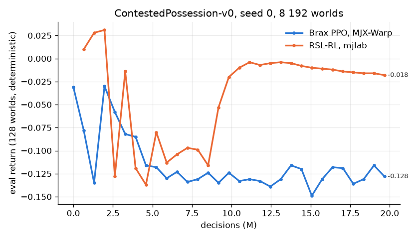

# 07 — RSL-RL (mjlab) × Brax PPO (MJX-Warp) (ticket 12)

Medido em 2026-11-16, RTX 3060 12 GB, um processo por backend sob `MemoryMax=10G`
([`../bench/train12.sh`](../bench/train12.sh) → [`../bench/train12/`](../bench/train12/);
curvas por [`../bench/plot12.py`](../bench/plot12.py)). Relatório, não gate.

**Escopo reduzido pelo usuário**: uma task (ContestedPossession) e uma seed (0), não as duas
tasks × seeds 0-4 do ticket. Sem mediana nem [p25, p75]: com uma seed, a curva é um run só,
e a diferença abaixo não separa backend de sorte de seed.

## Setup

Igual nos dois: `ContestedPossession-v0`, seed 0, 8 192 mundos, 19 660 800 decisões
(o orçamento default do `ppo_mjx` no ticket 13), 30 épocas, eval de 128 mundos determinística
(um episódio por mundo) ao fim de cada época, flags de PPO nos defaults (lr 3e-4, entropia
1e-2, γ 0,99, λ 0,95, clip 0,2, unroll 20, 32 minibatches, 4 updates).

O que os "mesmos hiperparâmetros de partida" não igualam (mapeamento do ticket 06):

- **Passos de gradiente por decisão**: a iteração do Brax junta 4 unrolls de cada mundo
  (`batch_size = num_envs/8` × 32 minibatches) para 4 × 32 updates; a do RSL-RL junta 1 unroll
  para os mesmos 4 × 32. O RSL-RL faz **4× mais passos de gradiente por decisão**, em
  minibatches 4× menores.
- Política: tanh-normal no Brax, Gaussiana com σ escalar e clip na caixa no RSL-RL.

## Resultado

| | Brax PPO, MJX-Warp | RSL-RL, mjlab |
|---|---:|---:|
| eval return final (19,7 M) | −0,128 | −0,018 |
| melhor eval return | −0,030 (2,0 M) | 0,031 (2,0 M) |
| duração do episódio de eval final | 554 | 1 200 (time-out) |
| decisões/s de treino (mediana das épocas) | 16 795 | 16 226 |
| decisões/s ponta a ponta (com eval) | 8 880 | ~9 600 (2 051 s) |
| falhas (diverged/overflow/overlap) | 0 | 0 no treino e na eval |

- **Velocidade**: empate no treino (−3 % para o mjlab), como no protótipo e no ticket 08. No
  ponta a ponta o mjlab termina antes (2 051 × 2 275 s): a eval do Brax custa mais.
- **Retorno**: nenhum dos dois aprende a task nesse orçamento. O Brax cai para ~−0,13 a partir
  de ~4 M decisões e fica ali (a política perde a posse a meio episódio). O RSL-RL oscila na
  mesma faixa até ~8,5 M e depois converge para ~0, segurando o episódio até o time-out sem
  pontuar. Na seed 0, o RSL-RL termina melhor, mas é um run só.

## Confusão no setup: episódios cortados a 80 decisões

O `--timesteps 19660800` em 30 épocas dá 1 iteração do Brax (80 decisões por mundo) e 4 do
RSL-RL (também 80 decisões por mundo) por época, e os dois scripts refazem os primeiros estados
a cada época. O episódio tem até 1 200 decisões: no treino, **nenhum mundo passa de 80
decisões** de um episódio, e a eval pede 1 200. Os dois backends sofrem o mesmo corte (a
comparação continua justa), mas isso explica por que nenhum aprende. O default dos scripts
(`--timesteps` vazio) evita o corte: uma época = um episódio de cada mundo (~9,8 M decisões a
8 192 mundos). No ticket 11, o mjlab com 19 iterações por época (380 decisões) chegou a 0,26 em
3 M decisões; o run do ticket 13 do Brax, antes do refazer por época, a 0,163 em 19,7 M.

## Para fechar a pergunta de verdade

Rodar de novo com o default (épocas de um episódio; 2 épocas no mesmo orçamento, ou mais
orçamento para ter curva), seeds 0-4, e a GoToBall. ~70 min por par de runs na
ContestedPossession; ~2-3 h na GoToBall.
