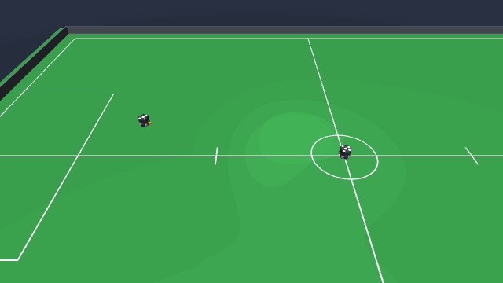

# ContestedPossession-v0



| | |
|---|---|
| Action Space | `Box(-1.0, 1.0, (7,), float32)` |
| Observation Space | `Box((22,), float32)`, bounded per row below |
| import | `gym.make("ContestedPossession-v0")` |

## Description

rSoccer's `SSLContestedPossession-v0`: a yellow robot sits on the ball in front of the
goal, facing away from it, and the blue robot has to score past it. The reward and endings are
[`GoToBallShoot-v0`](go_to_ball_shoot.md)'s, plus rSoccer's collision rule: the episode ends the
moment the yellow robot is moving faster than 0.1 m/s on x or y. So the ball has to be taken
off it without shoving it.

The yellow robot gets no commands: it does not drive and its dribbler is off, so the ball rests
in its mouth without being held.

## Action Space

The action is a `Box(-1, 1, (7,), float32)` and drives the blue robot
only; the yellow robot is scripted and never appears in it. Every element is normalised:
the target pose by the half field, kick, chip and dribble by their actuators' `ctrlrange`.

| Num | Action | Min | Max | Unit |
|---|---|---|---|---|
| 0 | target x | -6.0 | 6.0 | m, `a * 6.0` (`FIELD_HALF_X`) |
| 1 | target y | -4.5 | 4.5 | m, `a * 4.5` (`FIELD_HALF_Y`) |
| 2 | sin of the target heading | -1 | 1 | heading `atan2(a_2, a_3)` |
| 3 | cos of the target heading | -1 | 1 | |
| 4 | kicker plunger force (`kicker_force`) | 0 | 500 | N, a one-step pulse for `6.5 * a` m/s when a > 0 |
| 5 | chipper plunger force (`chipper_force`) | 0 | 500 | N, a one-step pulse for `6.5 * a` m/s when a > 0 |
| 6 | dribbler bar speed (`dribbler_vel`) | 0 | 314 | rad/s |

Firing the kicker or the chipper — rows 4 and 5 — is
available but self-defeating here: a ball punched away from the contest cannot be held for
half a second, and the plunger then locks out for 250 ms. Rows 0-3 are a target pose (target velocity 0) that the navigation controller turns
into a body-frame velocity every 25 ms control step (see the index). See
[the action space contract](../index.md#action-space).

A robot that is not even driving keeps a ball on 114-118 of 120 idle steps. See
[Possession](../index.md#possession).

## Observation Space

`Box((22,), float32)`, bounded per row below: 6 ball elements plus 8 for each of the 2 robots, the
controlled blue robot first and the yellow opponent second.

| Num | Observation | Min | Max | Name in XML / source | Unit |
|---|---|---|---|---|---|
| 0 | ball x position | -Inf | Inf | `ball` | m, / 6.0 (`FIELD_HALF_X`) |
| 1 | ball y position | -Inf | Inf | `ball` | m, / 4.5 (`FIELD_HALF_Y`) |
| 2 | ball height above the carpet | 0 | Inf | `ball` | m, / 0.155 (`GOAL_HEIGHT`) |
| 3 | ball x velocity | -Inf | Inf | `ball` | m/s, / 8.0 (`MAX_BALL_V`) |
| 4 | ball y velocity | -Inf | Inf | `ball` | m/s, / 8.0 (`MAX_BALL_V`) |
| 5 | ball z velocity | -Inf | Inf | `ball` | m/s, / 8.0 (`MAX_BALL_V`) |
| 6 | x position of the controlled blue robot | -1.05 | 1.05 | `b0_robot` | m, / 6.0 (`FIELD_HALF_X`) |
| 7 | y position of the controlled blue robot | -1.067 | 1.067 | `b0_robot` | m, / 4.5 (`FIELD_HALF_Y`) |
| 8 | sin of the yaw of the controlled blue robot | -1 | 1 | `b0_robot` | unitless |
| 9 | cos of the yaw of the controlled blue robot | -1 | 1 | `b0_robot` | unitless |
| 10 | world-frame x velocity of the controlled blue robot | -Inf | Inf | `b0_robot` | m/s, / 3.3 (`MAX_V`) |
| 11 | world-frame y velocity of the controlled blue robot | -Inf | Inf | `b0_robot` | m/s, / 3.3 (`MAX_V`) |
| 12 | yaw rate of the controlled blue robot | -Inf | Inf | `b0_robot` | rad/s, / 37.1 (`MAX_W`) |
| 13 | whether the controlled blue robot has the ball | 0 | 1 | `BaseEnv.holds` | 0 or 1 |
| 14 | x position of the yellow opponent | -1.05 | 1.05 | `y0_robot` | m, / 6.0 (`FIELD_HALF_X`) |
| 15 | y position of the yellow opponent | -1.067 | 1.067 | `y0_robot` | m, / 4.5 (`FIELD_HALF_Y`) |
| 16 | sin of the yaw of the yellow opponent | -1 | 1 | `y0_robot` | unitless |
| 17 | cos of the yaw of the yellow opponent | -1 | 1 | `y0_robot` | unitless |
| 18 | world-frame x velocity of the yellow opponent | -Inf | Inf | `y0_robot` | m/s, / 3.3 (`MAX_V`) |
| 19 | world-frame y velocity of the yellow opponent | -Inf | Inf | `y0_robot` | m/s, / 3.3 (`MAX_V`) |
| 20 | yaw rate of the yellow opponent | -Inf | Inf | `y0_robot` | rad/s, / 37.1 (`MAX_W`) |
| 21 | whether the yellow opponent has the ball | 0 | 1 | `BaseEnv.holds` | 0 or 1 |

Element 21 is the one the task turns on: it is the opponent's possession flag, computed the
same way as the agent's, so the policy can see the contest as it happens rather than
inferring it from the ball position. Element 13 is the agent's own flag, which is also the
quantity the termination counter integrates. Elements 16 and 17 give the opponent's
heading, which matters because the ball is in front of it: the direction the yellow mouth
faces is the direction the ball cannot be taken from.

## Rewards

Ported from rSoccer's `_calculate_reward_and_done` (`ssl_go_to_ball_shoot`, and the
identical one in `ssl_hw_challenge`). Per step, unless the step ends the episode:

| term | value |
|---|---|
| ball distance | `clip(prev_dist - dist, -1, 1) / BALL_DIST_SCALE`, robot-to-ball closing; `BALL_DIST_SCALE = hypot(9.0, 6.0) = 10.8` |
| ball gradient | `clip(prev - now, -1, 1) / BALL_GRAD_SCALE`, the ball closing on the goal centre `(6.0, 0)`; `BALL_GRAD_SCALE = hypot(4.5, 6.0) / 4 = 1.875` |
| energy | `-mean(|a_drive|) / 1200` |

On an ending step the only reward is the goal: `+5.0` for a ball past `x = 6.0` inside the
mouth, `0` for anything else. There are no penalties. The scales are rSoccer's formulas on our
field. rSoccer's energy is `sum |wheel speed| / (4 * 160 rad/s * 1200)`; here the navigation controller's
command, as a fraction of the servo range, stands in for the wheel speed (the chassis commands `(vx, vy, w)`, not
wheels), so a saturated drive costs `1 / 1200` a step as there.

The collision step still pays the shaping, as in rSoccer, where the collision check does not
skip the reward.

## Starting State

rSoccer's layout. The blue robot starts at `(0, 0)` facing +x. The yellow robot is uniform
over `x` in `[1.8, 4.2]` (penalty depth to half-length less penalty depth) and `y` in
`[-1.8, 1.8]` (the penalty area's width), facing -x. rSoccer puts the ball 0.1 m in front of it;
here `seat_ball` rolls it into the yellow robot's mouth with the bar spinning, which leaves it
resting at about 0.095 m, because a ball placed touching the bar is a compressed spring.

## Episode End

### Termination

Checked in rSoccer's order, the first that holds ends the episode:

- **Collision.** The yellow robot moves faster than 0.1 m/s on x or y. `info["collision"]`.
  Checked first, but it does not stop the checks below from setting the step's reward.
- **Robot out.** The robot leaves the attacking half (`x < -0.2`) or the field's width
  (`|y| > 4.5`). `info["robot_out"]`.
- **Goalkeeper area.** The robot enters the +x penalty area (`x > 4.2`, `|y| < 1.8`, Div A's
  1.8 x 3.6 m). `info["gk_area"]`.
- **Ball out.** The ball leaves the attacking half (`x < 0`) or the width. `info["ball_out"]`.
- **Goal line.** The ball crosses `x = 6.0`: `+5.0` and `info["goal"]` inside the mouth (and
  under the crossbar), `0` wide.
- **Diverged simulation.** If `qpos` or `qvel` stops being finite, `step` raises
  `RuntimeError` rather than returning a NaN observation to train on.

### Truncation

`steps >= max_steps`, where `max_steps = round(horizon_s / dt)`. The default horizon is
**30 s**, rSoccer's: **1200 control steps** at the fixed 40 Hz (0.025 s), rSoccer's step.

## Arguments

| parameter | type | default | description |
|---|---|---|---|
| `repeat_action` | `int` | `1` | control steps (25 ms each, fixed 40 Hz) one decision is held for |
| `horizon_s` | `float` | `30.0` | truncation horizon, in seconds |
| `render_mode` | `str \| None` | `None` | `"human"` or `"rgb_array"` |

```python
import gymnasium as gym
import mjsoccer

env = gym.make("ContestedPossession-v0", horizon_s=30.0, render_mode="rgb_array")
```

`hold_seconds` (2.0) and `n_yellow` (1) are class attributes on `ContestedPossessionEnv`,
not `gym.make` keywords.

## Info dictionary

| key | type | description |
|---|---|---|
| `is_success` | `bool` | the ball ended up in the goal |
| `goal` | `bool` | present on a step the ball crossed the goal line: inside the mouth or not |
| `robot_out` | `bool` | present when the robot left the attacking half or the width |
| `gk_area` | `bool` | present when the robot entered the penalty area |
| `ball_out` | `bool` | present when the ball left the attacking half or the width |
| `collision` | `bool` | present when the yellow robot was shoved over 0.1 m/s |

## Version History

- v0: initial release.
