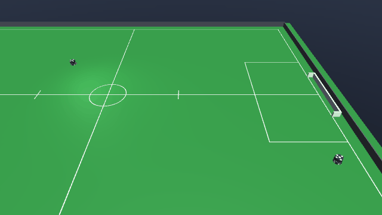

# ContestedPossession-v0



| | |
|---|---|
| Action Space | `Box(-1.0, 1.0, (7,), float32)` on the default tier 1, `Box(-1.0, 1.0, (6,), float32)` on tier 0 |
| Observation Space | `Box(-inf, inf, (22,), float32)` |
| import | `gym.make("ContestedPossession-v0")` |

## Description

A yellow robot starts with the ball seated in its dribbler and its bar spinning. The blue
robot has to take the ball off it and hold it for half a second.

This is the only task in the suite where the ball starts in somebody else's mouth. The
yellow robot does not drive — its only scripted behaviour is running its dribbler at
`DRIBBLER_OMEGA` every step — but that is enough to make the ball genuinely hard to take:
the bar holds the ball against the mouth by friction, so it cannot simply be driven into
from the front. It has to be knocked loose by contact with the chassis, or the blue robot
has to get its own bar onto the ball at an angle the yellow bar is not covering. The yellow
robot is not anchored, so it can be pushed.

The half-second hold requirement is what makes the task about *possession* rather than
contact: brushing the ball is not enough, and neither is knocking it away, because the blue
robot has to end up carrying it. Termination uses the same contact-with-grace definition of
possession as everything else in the suite, which is what makes a fractional-second hold
measurable at all — see [Possession](../index.md#possession).

## Action Space

The action is a `Box(-1, 1, (7,), float32)` on the default tier 1 and drives the blue robot
only; the yellow robot is scripted and never appears in it. Every element is normalised and
scaled internally by the actuator's own `ctrlrange`.

| Num | Action | Min | Max | Unit |
|---|---|---|---|---|
| 0 | wheel 1 speed (`wheel1_vel`) | -200 | 200 | rad/s |
| 1 | wheel 2 speed (`wheel2_vel`) | -200 | 200 | rad/s |
| 2 | wheel 3 speed (`wheel3_vel`) | -200 | 200 | rad/s |
| 3 | wheel 4 speed (`wheel4_vel`) | -200 | 200 | rad/s |
| 4 | kicker plunger force (`kicker_force`) | 0 | 200 | N, fired as a pulse when the action > 0 |
| 5 | chipper plunger force (`chipper_force`) | 0 | 200 | N, fired as a pulse when the action > 0 |
| 6 | dribbler bar speed (`dribbler_vel`) | 0 | 314 | rad/s |

On tier 0 the action is a `Box(-1, 1, (6,), float32)`: the four wheel servos are replaced by
the three chassis rows, and kicker, chipper and dribbler shift down to indices 3, 4 and 5.

| Num | Action | Min | Max | Unit |
|---|---|---|---|---|
| 0 | body-frame forward velocity (`vel_x`) | -4 | 4 | m/s |
| 1 | body-frame lateral velocity (`vel_y`) | -4 | 4 | m/s |
| 2 | yaw rate (`vel_yaw`) | -30 | 30 | rad/s |
| 3 | kicker plunger force (`kicker_force`) | 0 | 200 | N, fired as a pulse when the action > 0 |
| 4 | chipper plunger force (`chipper_force`) | 0 | 200 | N, fired as a pulse when the action > 0 |
| 5 | dribbler bar speed (`dribbler_vel`) | 0 | 314 | rad/s |

Firing the kicker or the chipper — rows 4 and 5 on tier 1, rows 3 and 4 on tier 0 — is
available but self-defeating here: a ball punched away from the contest cannot be held for
half a second, and the plunger then locks out for 250 ms. Rows 0-3 on tier 1 are the four
wheel servos; rows 0-2 on tier 0 are instead a *body-frame* velocity that is rotated into
the world-axis chassis slides before being written. See
[the action space contract](../index.md#action-space).

The half-second hold is also measurably harder to complete on tier 1: a robot that is not
even driving keeps ball contact on 87-95 of 120 idle steps there against 96-103 on tier 0,
because wheel slip lets the chassis recoil off the ball. See
[Possession](../index.md#possession).

## Observation Space

`Box(-inf, inf, (22,), float32)`: 6 ball elements plus 8 for each of the 2 robots, the
controlled blue robot first and the yellow opponent second.

| Num | Observation | Min | Max | Name in XML / source | Unit |
|---|---|---|---|---|---|
| 0 | ball x position | -Inf | Inf | `ball` | m, / 6.0 (`FIELD_HALF_X`) |
| 1 | ball y position | -Inf | Inf | `ball` | m, / 4.5 (`FIELD_HALF_Y`) |
| 2 | ball height | -Inf | Inf | `ball` | m, / 0.155 (`GOAL_HEIGHT`) |
| 3 | ball x velocity | -Inf | Inf | `ball` | m/s, / 8.0 (`MAX_BALL_V`) |
| 4 | ball y velocity | -Inf | Inf | `ball` | m/s, / 8.0 (`MAX_BALL_V`) |
| 5 | ball z velocity | -Inf | Inf | `ball` | m/s, / 8.0 (`MAX_BALL_V`) |
| 6 | x position of the controlled blue robot | -Inf | Inf | `b0_robot` | m, / 6.0 (`FIELD_HALF_X`) |
| 7 | y position of the controlled blue robot | -Inf | Inf | `b0_robot` | m, / 4.5 (`FIELD_HALF_Y`) |
| 8 | sin of the yaw of the controlled blue robot | -1 | 1 | `b0_robot` | unitless |
| 9 | cos of the yaw of the controlled blue robot | -1 | 1 | `b0_robot` | unitless |
| 10 | world-frame x velocity of the controlled blue robot | -Inf | Inf | `b0_robot` | m/s, / 4.0 (`MAX_V`) |
| 11 | world-frame y velocity of the controlled blue robot | -Inf | Inf | `b0_robot` | m/s, / 4.0 (`MAX_V`) |
| 12 | yaw rate of the controlled blue robot | -Inf | Inf | `b0_robot` | rad/s, / 30.0 (`MAX_W`) |
| 13 | whether the controlled blue robot has the ball | 0 | 1 | `BaseEnv.holds` | 0 or 1 |
| 14 | x position of the yellow opponent | -Inf | Inf | `y0_robot` | m, / 6.0 (`FIELD_HALF_X`) |
| 15 | y position of the yellow opponent | -Inf | Inf | `y0_robot` | m, / 4.5 (`FIELD_HALF_Y`) |
| 16 | sin of the yaw of the yellow opponent | -1 | 1 | `y0_robot` | unitless |
| 17 | cos of the yaw of the yellow opponent | -1 | 1 | `y0_robot` | unitless |
| 18 | world-frame x velocity of the yellow opponent | -Inf | Inf | `y0_robot` | m/s, / 4.0 (`MAX_V`) |
| 19 | world-frame y velocity of the yellow opponent | -Inf | Inf | `y0_robot` | m/s, / 4.0 (`MAX_V`) |
| 20 | yaw rate of the yellow opponent | -Inf | Inf | `y0_robot` | rad/s, / 30.0 (`MAX_W`) |
| 21 | whether the yellow opponent has the ball | 0 | 1 | `BaseEnv.holds` | 0 or 1 |

Element 21 is the one the task turns on: it is the opponent's possession flag, computed the
same way as the agent's, so the policy can see the contest as it happens rather than
inferring it from the ball position. Element 13 is the agent's own flag, which is also the
quantity the termination counter integrates. Elements 16 and 17 give the opponent's
heading, which matters because the ball is in front of it: the direction the yellow mouth
faces is the direction the ball cannot be taken from.

## Rewards

Per step:

| term | value |
|---|---|
| approach shaping | `prev_dist - dist`, the decrease in blue-robot-to-ball distance |
| holding bonus | `+0.05 * holds(0)` |
| energy | `-0.001 * ||a||^2` |
| steal bonus | `+10.0` on the terminating step |

The approach term is potential-based — the *decrease* in the distance from the blue robot to
the ball over one step — so total shaping is bounded by the starting distance (at least 1 m,
by the reset clearance) and no cycle pays. Because the ball moves during the contest, this
term also credits chasing a ball that has been knocked loose, and debits letting the
opponent carry it away.

The `+0.05` holding bonus is the only dense signal that distinguishes touching the ball from
taking it. It is not potential-based, but it is bounded per step and cannot exceed
`0.05 * 1250 = 62.5` over the horizon — and in practice it cannot be farmed for long,
because holding the ball for 31 consecutive steps ends the episode with the `+10` bonus
anyway.

`ENERGY = 0.001` multiplies the squared norm of the whole flat action, summing over all 7
dimensions on the default tier 1 (6 on tier 0), so a saturated action costs `-0.007` per
step on tier 1, `-0.006` on tier 0.

## Starting State

`_place` samples the yellow robot first, then the blue one, both with `sample_pose` at a
**1.0 m** clearance — the largest separation in the suite except `PassEndurance-v0` — so the
agent never starts already on top of the contest. Both are uniform in `x` over
`[-5.7, 5.7]` and `y` over `[-4.2, 4.2]`, with yaw uniform in `[-pi, pi)`. Note that the
clearance is measured between chassis centres and against previously placed objects only.

`_reset_task` then seats the ball in the **opponent's** mouth with `BaseEnv.seat_ball`: the
ball is put 0.20 m in front of the yellow robot moving at 2 m/s straight at it, the yellow
dribbler is set to `DRIBBLER_OMEGA`, and 0.35 s of physics is run so the mechanism catches
it. The premise of the task is that the opponent already has the ball, and this is the way
the mechanism actually takes one. Placing the ball at the sphere/bar tangency instead is a
launcher, not a seat: the contact needs a few tenths of a millimetre of overlap to exist at
all, and on a 46 g ball that overlap is a compressed spring worth several newtons; below
about 0.1 mm MuJoCo stops generating the contact entirely.

Because `seat_ball` steps the simulation, the yellow robot's own settle-in motion is part of
the initial state: it recoils slightly from catching the ball. The blue robot's baseline
distance and the hold counter are recorded after that.

`_script` runs every step and writes `DRIBBLER_OMEGA` to the yellow dribbler. Nothing else
about the yellow robot is driven: it has no drive command, so it coasts if pushed.

## Episode End

### Termination

- **Success.** `holds(0)` has been true for `hold_seconds = 0.5` s of continuous simulated
  time — 31 control steps at the default rate. The counter resets to zero the moment
  `holds(0)` goes false, so the half-second has to be unbroken. `holds` itself already
  tolerates a 50 ms gap in ball/dribbler contact, which is what makes an unbroken half
  second achievable with a bar that sticks and re-grips.
- **Ball out of the field.** `scene.in_field` fails for the ball centre (`|x| > 6.0 m` or
  `|y| > 4.5 m`); `info["ball_out"]` is set. This env never sets `info["goal"]`, so any
  ball leaving the field, including over a goal line, ends the episode.
- **Diverged simulation.** If `qpos` or `qvel` stops being finite, `step` raises
  `RuntimeError` rather than returning a NaN observation to train on. This is an error, not
  a normal termination.

The episode does not end when the opponent loses the ball, only when the agent has held it
long enough.

### Truncation

`steps >= max_steps`, where `max_steps = round(horizon_s / dt)`. The default horizon is
**20 s**, and at the default `control_hz=60` the actual `dt` is 0.016 s, so **1250 steps**.

## Arguments

| parameter | type | default | description |
|---|---|---|---|
| `tier` | `int` | `1` | `1` = roller wheels with real slip, the default; `0` = the faster kinematic chassis |
| `control_hz` | `int` | `60` | requested control rate; rounded to a whole number of 2 ms physics steps, so 60 becomes 62.5 Hz |
| `horizon_s` | `float` | `20.0` | truncation horizon, in seconds |
| `render_mode` | `str \| None` | `None` | `"human"` or `"rgb_array"` |

```python
import gymnasium as gym
import mjsoccer

env = gym.make("ContestedPossession-v0", tier=0, control_hz=60, horizon_s=20.0, render_mode="rgb_array")
```

`hold_seconds` (0.5) and `n_yellow` (1) are class attributes on `ContestedPossessionEnv`,
not `gym.make` keywords.

## Info dictionary

| key | type | description |
|---|---|---|
| `is_success` | `bool` | the agent held the ball for a continuous 0.5 s |
| `ball_out` | `bool` | present only on the step the ball leaves the field |

## Version History

- v0: initial release.
