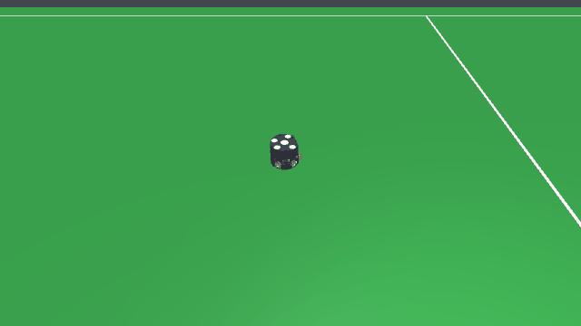

# Dribbling-v0



| | |
|---|---|
| Action Space | `Box(-1.0, 1.0, (7,), float32)` on the default tier 1, `Box(-1.0, 1.0, (6,), float32)` on tier 0 |
| Observation Space | `Box(-inf, inf, (16,), float32)` |
| import | `gym.make("Dribbling-v0")` |

## Description

The episode starts with the ball already seated in the robot's dribbler, and the robot has
to carry it through four waypoints in a row without dropping it. Each waypoint is a random
point on the field; reaching one within 0.3 m while still holding the ball scores it and
immediately draws the next.

The task isolates *retention*. Getting to the ball is `GoToBall-v0`'s job, so this
environment skips it entirely and hands the robot a ball it must not lose. What makes that
hard is that the dribbler is a real mechanism, not a magnet: a bar spinning at 314 rad/s
holds the ball by friction against the mouth, and it lets go if the chassis accelerates
sideways hard enough, turns faster than the ball can follow, or drives into anything.
Carrying the ball fast and carrying it at all are in direct tension.

How hard that is depends on the tier. Sitting still on a seated ball, tier 0 keeps contact
on every one of 120 idle steps (bar at `dribble = 0.5`) while the default tier 1 keeps it on 111-112, because wheel
slip lets the chassis recoil off the ball it is holding — see
[Possession](../index.md#possession). Retention numbers from this environment are therefore
only comparable within a tier.

The agent can also kick or chip its own carried ball away — those controls are always in
the action space, in every environment. It is not worth doing here: the shaping below is
gated on `holds(0)`, so the step the ball leaves the mouth is the step progress stops
paying, and the loss timer starts.

## Action Space

The action is a `Box(-1, 1, (7,), float32)` on the default tier 1. Every element is
normalised and scaled internally by the actuator's own `ctrlrange`, so the physical bounds
below come from the model, not from a constant in the environment.

| Num | Action | Min | Max | Unit |
|---|---|---|---|---|
| 0 | wheel 1 speed (`wheel1_vel`) | -200 | 200 | rad/s |
| 1 | wheel 2 speed (`wheel2_vel`) | -200 | 200 | rad/s |
| 2 | wheel 3 speed (`wheel3_vel`) | -200 | 200 | rad/s |
| 3 | wheel 4 speed (`wheel4_vel`) | -200 | 200 | rad/s |
| 4 | kicker plunger force (`kicker_force`) | 0 | 500 | N, a one-step pulse for `6.5 * a` m/s when a > 0 |
| 5 | chipper plunger force (`chipper_force`) | 0 | 500 | N, a one-step pulse for `6.5 * a` m/s when a > 0 |
| 6 | dribbler bar speed (`dribbler_vel`) | 0 | 314 | rad/s |

On tier 0 the action is a `Box(-1, 1, (6,), float32)`: the four wheel servos are replaced by
the three chassis rows, and kicker, chipper and dribbler shift down to indices 3, 4 and 5.

| Num | Action | Min | Max | Unit |
|---|---|---|---|---|
| 0 | body-frame forward velocity (`vel_x`) | -4 | 4 | m/s |
| 1 | body-frame lateral velocity (`vel_y`) | -4 | 4 | m/s |
| 2 | yaw rate (`vel_yaw`) | -30 | 30 | rad/s |
| 3 | kicker plunger force (`kicker_force`) | 0 | 500 | N, a one-step pulse for `6.5 * a` m/s when a > 0 |
| 4 | chipper plunger force (`chipper_force`) | 0 | 500 | N, a one-step pulse for `6.5 * a` m/s when a > 0 |
| 5 | dribbler bar speed (`dribbler_vel`) | 0 | 314 | rad/s |

Row 6 on the default tier 1 — row 5 on tier 0 — is the one the task actually turns on:
`a <= 0` is a stopped bar, which drops the ball, and `(0, 1]` maps to `(0, 314] rad/s` -- so a
zero action does not hold it. The bar is never driven backwards — a reversed bar throws the ball out of
the mouth. Rows 0-3 on tier 1 are the four wheel servos, whose slip is what makes retention
harder here than on tier 0 (see [Possession](../index.md#possession)); rows 0-2 on tier 0
are instead a *body-frame* velocity that is rotated into the world-axis chassis slides
before being written. See [the action space contract](../index.md#action-space) for the
rest.

## Observation Space

`Box(-inf, inf, (16,), float32)`: 6 ball elements, 8 for the single robot, and 2 task
extras (`extra_obs = 2`).

| Num | Observation | Min | Max | Name in XML / source | Unit |
|---|---|---|---|---|---|
| 0 | ball x position | -Inf | Inf | `ball` | m, / 6.0 (`FIELD_HALF_X`) |
| 1 | ball y position | -Inf | Inf | `ball` | m, / 4.5 (`FIELD_HALF_Y`) |
| 2 | ball height | -Inf | Inf | `ball` | m, / 0.155 (`GOAL_HEIGHT`) |
| 3 | ball x velocity | -Inf | Inf | `ball` | m/s, / 8.0 (`MAX_BALL_V`) |
| 4 | ball y velocity | -Inf | Inf | `ball` | m/s, / 8.0 (`MAX_BALL_V`) |
| 5 | ball z velocity | -Inf | Inf | `ball` | m/s, / 8.0 (`MAX_BALL_V`) |
| 6 | x position of the controlled blue robot | -Inf | Inf | `b0_robot` | m, / 6.0 (`FIELD_HALF_X`) |
| 7 | y position of the controlled blue robot | -Inf | Inf | `b0_robot` | m, / 4.5 (`FIELD_HALF_Y`) |
| 8 | sin of the yaw of the controlled blue robot | -1 | 1 | `b0_robot` | unitless |
| 9 | cos of the yaw of the controlled blue robot | -1 | 1 | `b0_robot` | unitless |
| 10 | world-frame x velocity of the controlled blue robot | -Inf | Inf | `b0_robot` | m/s, / 4.0 (`MAX_V`) |
| 11 | world-frame y velocity of the controlled blue robot | -Inf | Inf | `b0_robot` | m/s, / 4.0 (`MAX_V`) |
| 12 | yaw rate of the controlled blue robot | -Inf | Inf | `b0_robot` | rad/s, / 30.0 (`MAX_W`) |
| 13 | whether the controlled blue robot has the ball | 0 | 1 | `BaseEnv.holds` | 0 or 1 |
| 14 | waypoint x in the robot's own frame | -Inf | Inf | `DribblingEnv._target` | m, / 6.0 (`FIELD_HALF_X`) |
| 15 | waypoint y in the robot's own frame | -Inf | Inf | `DribblingEnv._target` | m, / 4.5 (`FIELD_HALF_Y`) |

Elements 14 and 15 are the *current* waypoint expressed in the robot's own frame — the
world offset rotated by the transpose of the chassis orientation, then divided
componentwise by `(FIELD_HALF_X, FIELD_HALF_Y)`. A body-frame target is what the drive
command is also expressed in, so the policy does not have to learn the rotation twice.
Only the current waypoint is visible; the next one is drawn at random the instant this one
is scored, so there is nothing to look ahead to.

## Rewards

Per step:

| term | value |
|---|---|
| carry shaping | `(prev_dist - dist) * holds(0)`, the decrease in ball-to-waypoint distance, only while the ball is held |
| holding bonus | `+0.01 * holds(0)` |
| energy | `-0.001 * ||a||^2` |
| waypoint bonus | `+5.0` each time a waypoint is scored, up to 4 times |

The shaping is potential-based — the *decrease* in the ball-to-waypoint distance over one
step — so the total a policy can collect between two waypoints is bounded by the distance
between them and no cycle pays.

The `holds(0)` gate on the progress term is what stops the obvious exploit: without it a
policy can farm the shaping by kicking the ball at the waypoint and walking away, since the
ball keeps closing on the target for free. Gated, the shaping stops the moment the ball
leaves the mouth, and the distance the ball covers loose is credited to nobody — when the
ball is recaptured, `prev_dist` has already moved with it. The `+0.01` holding bonus is a
small, constant reason to keep the bar on the ball even when the waypoint is not getting
closer; over the full 2500-step horizon it is worth at most `+25`.

`ENERGY = 0.001` multiplies the squared norm of the whole flat action, summing over all 7
dimensions on the default tier 1 (6 on tier 0) rather than just the drive channels, so a
saturated action costs `-0.007` per step on tier 1, `-0.006` on tier 0. It is what makes a
stray kick or chip cost
something on top of the gated shaping it forfeits.

## Starting State

`_place` places only the robot: one `sample_pose` draw, uniform in `x` over `[-5.7, 5.7]`
and `y` over `[-4.2, 4.2]`, with a 0.5 m clearance requirement that is trivially satisfied
because nothing else is placed yet, and yaw uniform in `[-pi, pi)`.

`_reset_task` then seats the ball by `BaseEnv.seat_ball`, which is not a teleport: it puts
the ball 0.20 m in front of the robot moving at 2 m/s straight at the mouth, sets the
dribbler to `DRIBBLER_OMEGA`, and runs 0.35 s of physics so the mechanism catches it. Doing
it this way — the way the real robot takes a ball — is necessary because placing the ball at
the sphere/bar tangency is a launcher, not a seat: the contact needs a few tenths of a
millimetre of overlap to exist at all, and on a 46 g ball that overlap is a compressed
spring worth several newtons; below about 0.1 mm MuJoCo stops generating the contact
entirely. Rolling it in also leaves the ball in the pocket the dribbler actually holds it
in, rather than one chosen with a ruler.

The first waypoint is then drawn with `sample_pose([], clearance=0.0)` — uniform inside the
0.3 m field margin, with no clearance constraint, so it can land on top of the robot. The
waypoint counter and the ball-lost counter start at zero, and the initial ball-to-waypoint
distance becomes the shaping baseline. Each subsequent waypoint is drawn the same way.

## Episode End

### Termination

Both of the task's own end conditions come back through the same `done` flag; only the
first is a success.

- **Success.** Four waypoints scored. A waypoint counts when the ball is within
  `waypoint_tol = 0.3 m` of it *and* `holds(0)` is true — arriving with a loose ball scores
  nothing.
- **Ball lost.** `holds(0)` has been false for more than 2 s of continuous simulated time —
  125 control steps at the default rate. `holds` itself already tolerates a 50 ms gap in
  ball/dribbler contact, so a bar that sticks and re-grips does not restart this timer.
  `info["is_success"]` is `False`.
- **Ball out of the field.** `scene.in_field` fails for the ball centre (`|x| > 6.0 m` or
  `|y| > 4.5 m`); `info["ball_out"]` is set. In practice this fires before the 2 s loss
  timer if the ball is kicked off the field.
- **Controlled robot turned over.** The robot's own +z tilts more than 60 deg off world
  +z (`cos < 0.5`). The step pays `-10.0` on top of whatever the task scored and
  `info["tipped"]` is set. Only the robots the policy controls count — a scripted robot on
  its side is the agent's to exploit. Tier 0 never trips this: its chassis is a planar
  joint and cannot leave the ground.
- **Diverged simulation.** If `qpos` or `qvel` stops being finite, `step` raises
  `RuntimeError` rather than returning a NaN observation to train on. This is an error, not
  a normal termination.

### Truncation

`steps >= max_steps`, where `max_steps = round(horizon_s / dt)`. The default horizon is
**40 s**, and at the default `control_hz=60` the actual `dt` is 0.016 s, so **2500 steps** —
the longest horizon in the suite, because four waypoints across a 12 x 9 m field is a lot of
ground to cover at a speed that keeps the ball.

## Arguments

| parameter | type | default | description |
|---|---|---|---|
| `tier` | `int` | `1` | `1` = roller wheels with real slip, the default; `0` = the faster kinematic chassis |
| `control_hz` | `int` | `60` | requested control rate; rounded to a whole number of 2 ms physics steps, so 60 becomes 62.5 Hz |
| `horizon_s` | `float` | `40.0` | truncation horizon, in seconds |
| `render_mode` | `str \| None` | `None` | `"human"` or `"rgb_array"` |

```python
import gymnasium as gym
import mjsoccer

env = gym.make("Dribbling-v0", tier=0, control_hz=60, horizon_s=40.0, render_mode="rgb_array")
```

`n_waypoints` (4) and `waypoint_tol` (0.3 m) are class attributes on `DribblingEnv`, not
`gym.make` keywords.

## Info dictionary

| key | type | description |
|---|---|---|
| `is_success` | `bool` | all four waypoints were scored |
| `waypoints` | `int` | how many waypoints have been scored so far, 0-4 |
| `ball_out` | `bool` | present only on the step the ball leaves the field |
| `tipped` | `bool` | present only on the step a controlled robot turned over |

## Version History

- v0: initial release.
