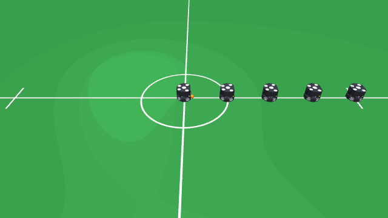

# Dribbling-v0



| | |
|---|---|
| Action Space | `Box(-1.0, 1.0, (7,), float32)` on the default tier 1, `Box(-1.0, 1.0, (6,), float32)` on tier 0 |
| Observation Space | `Box((47,), float32)`, bounded per row below |
| import | `gym.make("Dribbling-v0")` |

## Description

rSoccer's `SSLDribbling-v0`: the robot starts at the origin facing -x with the ball in its
dribbler, and four yellow robots stand on the line `y = 0` at `x = -0.5, -1.0, -1.5, -2.0`.
The gaps between them are checkpoints. The ball has to zigzag through: down across `y = 0`
between the first two, up between the second and third, then shuttle around the last robot —
down through the last gap, up beyond the last robot — until 7 checkpoints are passed.

The task is about *retention*: the dribbler is a real mechanism, not a magnet, and the
weaving makes the robot turn with the ball.

## Action Space

The action is a `Box(-1, 1, (7,), float32)` on the default tier 1. Every element is
normalised and scaled internally by the actuator's own `ctrlrange`, so the physical bounds
below come from the model, not from a constant in the environment.

| Num | Action | Min | Max | Unit |
|---|---|---|---|---|
| 0 | wheel 1 speed (`wheel1_vel`) | -95 | 95 | rad/s |
| 1 | wheel 2 speed (`wheel2_vel`) | -95 | 95 | rad/s |
| 2 | wheel 3 speed (`wheel3_vel`) | -95 | 95 | rad/s |
| 3 | wheel 4 speed (`wheel4_vel`) | -95 | 95 | rad/s |
| 4 | kicker plunger force (`kicker_force`) | 0 | 500 | N, a one-step pulse for `6.5 * a` m/s when a > 0 |
| 5 | chipper plunger force (`chipper_force`) | 0 | 500 | N, a one-step pulse for `6.5 * a` m/s when a > 0 |
| 6 | dribbler bar speed (`dribbler_vel`) | 0 | 314 | rad/s |

On tier 0 the action is a `Box(-1, 1, (6,), float32)`: the four wheel servos are replaced by
the three chassis rows, and kicker, chipper and dribbler shift down to indices 3, 4 and 5.

| Num | Action | Min | Max | Unit |
|---|---|---|---|---|
| 0 | body-frame forward velocity (`vel_x`) | -4 | 4 | m/s |
| 1 | body-frame lateral velocity (`vel_y`) | -4 | 4 | m/s |
| 2 | yaw rate (`vel_yaw`) | -30 | 30 | rad/s |
| 3 | kicker plunger force (`kicker_force`) | 0 | 500 | N, a one-step pulse for `6.5 * a` m/s when a > 0 |
| 4 | chipper plunger force (`chipper_force`) | 0 | 500 | N, a one-step pulse for `6.5 * a` m/s when a > 0 |
| 5 | dribbler bar speed (`dribbler_vel`) | 0 | 314 | rad/s |

Row 6 on the default tier 1 — row 5 on tier 0 — is the one the task actually turns on:
`a <= 0` is a stopped bar, which drops the ball, and `(0, 1]` maps to `(0, 314] rad/s` -- so a
zero action does not hold it. The bar is never driven backwards — a reversed bar throws the ball out of
the mouth. Rows 0-3 on tier 1 are the four wheel servos, whose slip is what makes retention
harder here than on tier 0 (see [Possession](../index.md#possession)); rows 0-2 on tier 0
are instead a *body-frame* velocity that is rotated into the world-axis chassis slides
before being written. See [the action space contract](../index.md#action-space) for the
rest.

## Observation Space

`Box((47,), float32)`: 6 ball elements, 8 for each of the 5 robots (the controlled blue robot,
then the four yellow ones, laid out as in [`StaticDefenders-v0`](static_defenders.md#observation-space)),
and one task extra, element 46: the checkpoints passed as rSoccer observes them,
`(count / 6) * 2 - 1`, in `[-1, 4/3]`.

## Rewards

rSoccer's: `+1.0` on the step the ball crosses the current checkpoint in the right direction,
`0` otherwise. With `count` the checkpoints passed and `last_y`, `y` the ball's `y` on the
previous and current step:

| count | where the ball has to be | crossing |
|---|---|---|
| 0 | `-1.0 < x < -0.5` | `last_y >= 0 > y` |
| 1 | `-1.5 < x < -1.0` | `last_y < 0 <= y` |
| even, >= 2 | `-2.0 < x < -1.5` | `last_y >= 0 > y` (the other way ends the episode) |
| odd, >= 3 | `-3.0 < x < -2.0` | `last_y < 0 <= y` |

No shaping, no possession term, no energy.

## Starting State

rSoccer's layout. The robot is at `(0, 0)` facing -x; the four yellow robots at
`x = -0.5, -1.0, -1.5, -2.0`, `y = 0`, facing -x. rSoccer puts the ball at `(-0.1, 0)`; here
`seat_ball` rolls it into the robot's spinning dribbler, so it starts genuinely held.

## Episode End

### Termination

- **Course completed.** The 7th checkpoint, `info["is_success"]`.
- **Backwards.** The ball crosses the last gap upwards while `count` is even and >= 2.
- **Robot out of the course.** `x < -3.0`, `x > 1.0` or `|y| > 1.0`.
- **Collision.** Any yellow robot moving faster than 0.05 m/s on x or y.
- **Controlled robot turned over** (tier 1 only). The robot's own +z tilts more than 60 deg
  off world +z (`cos < 0.5`); the step pays `-100.0` and `info["tipped"]` is set. rSoccer's
  robots cannot tip, so this is the one ending that is ours, kept so a robot on its back never
  collects shaping.
- **Diverged simulation.** If `qpos` or `qvel` stops being finite, `step` raises
  `RuntimeError` rather than returning a NaN observation to train on.

### Truncation

`steps >= max_steps`, where `max_steps = round(horizon_s / dt)`. The default horizon is
**120 s**, rSoccer's: **4800 steps** at the 40 Hz (0.025 s) the agents act at, rSoccer's step,
and 7200 at the default `control_hz=60`.

## Arguments

| parameter | type | default | description |
|---|---|---|---|
| `tier` | `int` | `1` | `1` = roller wheels with real slip, the default; `0` = the faster kinematic chassis |
| `control_hz` | `int` | `60` | control rate, exact: it must divide the 960 Hz physics rate (30, 60, 120, ...), or the env raises `ValueError` |
| `horizon_s` | `float` | `120.0` | truncation horizon, in seconds |
| `render_mode` | `str \| None` | `None` | `"human"` or `"rgb_array"` |

```python
import gymnasium as gym
import mjsoccer

env = gym.make("Dribbling-v0", tier=0, control_hz=60, horizon_s=120.0, render_mode="rgb_array")
```

## Info dictionary

| key | type | description |
|---|---|---|
| `is_success` | `bool` | all 7 checkpoints were passed |
| `checkpoints` | `int` | checkpoints passed so far, 0-7 |
| `tipped` | `bool` | present only on the step a controlled robot turned over |
| `tilt_deg` | `float` | with `tipped`: the worst controlled robot's tilt off vertical, degrees |
| `tip_step` | `int` | with `tipped`: control steps since reset, so time-to-tip is `tip_step * dt` |

## Version History

- v0: initial release.
