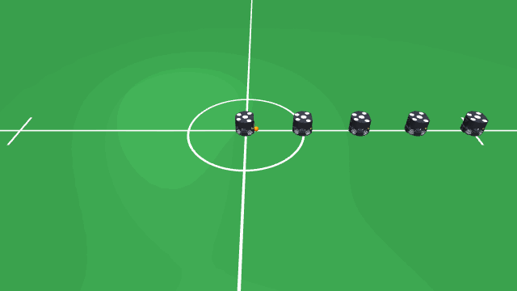

# Dribbling-v0



| | |
|---|---|
| Action Space | `Box(-1.0, 1.0, (7,), float32)` |
| Observation Space | `Box((47,), float32)`, bounded per row below |
| import | `gym.make("Dribbling-v0")` |

## Description

rSoccer's `SSLDribbling-v0`: the robot starts at the origin facing -x with the ball in its
dribbler, and four yellow robots stand on the line `y = 0` at `x = -0.5, -1.0, -1.5, -2.0`.
The gaps between them are checkpoints. The ball has to zigzag through: down across `y = 0`
between the first two, up between the second and third, then shuttle around the last robot —
down through the last gap, up beyond the last robot — until 7 checkpoints are passed.

The task is about *retention*: the dribbler is a real mechanism, not a magnet, and the
weaving makes the robot turn with the ball.

## Action Space

The action is a `Box(-1, 1, (7,), float32)` and drives the blue robot only; the yellow robots are
not controllable and never appear in it.

| Num | Action | Min | Max | Unit |
|---|---|---|---|---|
| 0 | target x | -6.0 | 6.0 | m, `a * 6.0` (`FIELD_HALF_X`) |
| 1 | target y | -4.5 | 4.5 | m, `a * 4.5` (`FIELD_HALF_Y`) |
| 2 | sin of the target heading | -1 | 1 | heading `atan2(a_2, a_3)` |
| 3 | cos of the target heading | -1 | 1 | |
| 4 | kick speed (`kicker_force`) | 0 | 6.5 | m/s, `6.5 * a` for `a > 0`; `a <= 0` does not fire |
| 5 | chip speed (`chipper_force`) | 0 | 6.5 | m/s, `6.5 * a` for `a > 0`; `a <= 0` does not fire |
| 6 | dribbler bar speed (`dribbler_vel`) | 0 | 314 | rad/s, `314 * max(a, 0)` (`DRIBBLER_OMEGA`) |

Rows 0-3 are a target pose (target velocity 0) that the navigation controller turns into a
body-frame velocity every 25 ms control step. Rows 4-5 ask for a ball speed, not a force:
`KICK_TABLE_MS` maps `6.5 * a` m/s to a one-step plunger force (`a = 1` lands at ~295-315 N;
the actuators' `ctrlrange` is 0..500 N). Each shot locks that plunger out for 250 ms; the
kicker and chipper locks are independent, so a kick cannot block a chip. Row 6 is off for
`a <= 0` and never drives the bar backwards (its `ctrlrange` is +-1500 rad/s; the action uses
only 0..314). See [the action space contract](../index.md#action-space).

Row 6 is the one the task turns on: `a <= 0` is a stopped bar, which drops the ball, so a
zero action does not hold it.

## Observation Space

`Box((47,), float32)`: 6 ball elements, 8 for each of the 5 robots (the controlled blue
robot, then the four yellow ones), and one task extra, element 46.

| Num | Observation | Min | Max | Name in XML / source | Unit |
|---|---|---|---|---|---|
| 0 | ball x position | -Inf | Inf | `ball` | m, / 6.0 (`FIELD_HALF_X`) |
| 1 | ball y position | -Inf | Inf | `ball` | m, / 4.5 (`FIELD_HALF_Y`) |
| 2 | ball height above the carpet | 0 | Inf | `ball` | m, / 0.155 (`GOAL_HEIGHT`) |
| 3 | ball x velocity | -Inf | Inf | `ball` | m/s, / 8.0 (`MAX_BALL_V`) |
| 4 | ball y velocity | -Inf | Inf | `ball` | m/s, / 8.0 (`MAX_BALL_V`) |
| 5 | ball z velocity | -Inf | Inf | `ball` | m/s, / 8.0 (`MAX_BALL_V`) |
| 6 | x position of the controlled blue robot | -1.05 | 1.05 | `b0_robot` | m, / 6.0 (`FIELD_HALF_X`) |
| 7 | y position of the controlled blue robot | -1.067 | 1.067 | `b0_robot` | m, / 4.5 (`FIELD_HALF_Y`) |
| 8 | sin of the yaw of the controlled blue robot | -1 | 1 | `b0_robot` | unitless |
| 9 | cos of the yaw of the controlled blue robot | -1 | 1 | `b0_robot` | unitless |
| 10 | world-frame x velocity of the controlled blue robot | -Inf | Inf | `b0_robot` | m/s, / 3.3 (`MAX_V`) |
| 11 | world-frame y velocity of the controlled blue robot | -Inf | Inf | `b0_robot` | m/s, / 3.3 (`MAX_V`) |
| 12 | yaw rate of the controlled blue robot | -Inf | Inf | `b0_robot` | rad/s, / 37.1 (`MAX_W`) |
| 13 | whether the controlled blue robot has the ball | 0 | 1 | `BaseEnv.holds` | 0 or 1 |
| 14 | x position of yellow robot 0 | -1.05 | 1.05 | `y0_robot` | m, / 6.0 (`FIELD_HALF_X`) |
| 15 | y position of yellow robot 0 | -1.067 | 1.067 | `y0_robot` | m, / 4.5 (`FIELD_HALF_Y`) |
| 16 | sin of the yaw of yellow robot 0 | -1 | 1 | `y0_robot` | unitless |
| 17 | cos of the yaw of yellow robot 0 | -1 | 1 | `y0_robot` | unitless |
| 18 | world-frame x velocity of yellow robot 0 | -Inf | Inf | `y0_robot` | m/s, / 3.3 (`MAX_V`) |
| 19 | world-frame y velocity of yellow robot 0 | -Inf | Inf | `y0_robot` | m/s, / 3.3 (`MAX_V`) |
| 20 | yaw rate of yellow robot 0 | -Inf | Inf | `y0_robot` | rad/s, / 37.1 (`MAX_W`) |
| 21 | whether yellow robot 0 has the ball | 0 | 1 | `BaseEnv.holds` | 0 or 1 |
| 22 | x position of yellow robot 1 | -1.05 | 1.05 | `y1_robot` | m, / 6.0 (`FIELD_HALF_X`) |
| 23 | y position of yellow robot 1 | -1.067 | 1.067 | `y1_robot` | m, / 4.5 (`FIELD_HALF_Y`) |
| 24 | sin of the yaw of yellow robot 1 | -1 | 1 | `y1_robot` | unitless |
| 25 | cos of the yaw of yellow robot 1 | -1 | 1 | `y1_robot` | unitless |
| 26 | world-frame x velocity of yellow robot 1 | -Inf | Inf | `y1_robot` | m/s, / 3.3 (`MAX_V`) |
| 27 | world-frame y velocity of yellow robot 1 | -Inf | Inf | `y1_robot` | m/s, / 3.3 (`MAX_V`) |
| 28 | yaw rate of yellow robot 1 | -Inf | Inf | `y1_robot` | rad/s, / 37.1 (`MAX_W`) |
| 29 | whether yellow robot 1 has the ball | 0 | 1 | `BaseEnv.holds` | 0 or 1 |
| 30 | x position of yellow robot 2 | -1.05 | 1.05 | `y2_robot` | m, / 6.0 (`FIELD_HALF_X`) |
| 31 | y position of yellow robot 2 | -1.067 | 1.067 | `y2_robot` | m, / 4.5 (`FIELD_HALF_Y`) |
| 32 | sin of the yaw of yellow robot 2 | -1 | 1 | `y2_robot` | unitless |
| 33 | cos of the yaw of yellow robot 2 | -1 | 1 | `y2_robot` | unitless |
| 34 | world-frame x velocity of yellow robot 2 | -Inf | Inf | `y2_robot` | m/s, / 3.3 (`MAX_V`) |
| 35 | world-frame y velocity of yellow robot 2 | -Inf | Inf | `y2_robot` | m/s, / 3.3 (`MAX_V`) |
| 36 | yaw rate of yellow robot 2 | -Inf | Inf | `y2_robot` | rad/s, / 37.1 (`MAX_W`) |
| 37 | whether yellow robot 2 has the ball | 0 | 1 | `BaseEnv.holds` | 0 or 1 |
| 38 | x position of yellow robot 3 | -1.05 | 1.05 | `y3_robot` | m, / 6.0 (`FIELD_HALF_X`) |
| 39 | y position of yellow robot 3 | -1.067 | 1.067 | `y3_robot` | m, / 4.5 (`FIELD_HALF_Y`) |
| 40 | sin of the yaw of yellow robot 3 | -1 | 1 | `y3_robot` | unitless |
| 41 | cos of the yaw of yellow robot 3 | -1 | 1 | `y3_robot` | unitless |
| 42 | world-frame x velocity of yellow robot 3 | -Inf | Inf | `y3_robot` | m/s, / 3.3 (`MAX_V`) |
| 43 | world-frame y velocity of yellow robot 3 | -Inf | Inf | `y3_robot` | m/s, / 3.3 (`MAX_V`) |
| 44 | yaw rate of yellow robot 3 | -Inf | Inf | `y3_robot` | rad/s, / 37.1 (`MAX_W`) |
| 45 | whether yellow robot 3 has the ball | 0 | 1 | `BaseEnv.holds` | 0 or 1 |
| 46 | checkpoints passed, `(count / 6) * 2 - 1` | -4/3 | 4/3 | `DribblingEnv._task_obs` | unitless, values in `[-1, 4/3]` |

Positions and velocities are divided by the constants in the Unit column; yaw is given as
its sine and cosine so the wrap at +-pi is not a discontinuity. Ball height is measured from
the carpet and normalised by `GOAL_HEIGHT = 0.155 m`, so a chipped ball reads greater than 1
exactly when it is too high to score. Only robot position, yaw and `has_ball` are bounded:
nothing clips, so a bound exists only where the field walls guarantee it.

Element 46 is the checkpoints passed as rSoccer observes them, `(count / 6) * 2 - 1`. With
`count` in 0..7 its values lie in `[-1, 4/3]`; the Box bound is `+-4/3`.

## Rewards

rSoccer's.

| term | value |
|---|---|
| checkpoint | `+1.0` on the step the ball crosses the current checkpoint in the right direction |

Every other step pays `0`. No shaping, no possession term, no energy. With `count` the
checkpoints passed and `last_y`, `y` the ball's `y` on the previous and current step:

| count | where the ball has to be | crossing |
|---|---|---|
| 0 | `-1.0 < x < -0.5` | `last_y >= 0 > y` |
| 1 | `-1.5 < x < -1.0` | `last_y < 0 <= y` |
| even, >= 2 | `-2.0 < x < -1.5` | `last_y >= 0 > y` (the other way ends the episode) |
| odd, >= 3 | `-3.0 < x < -2.0` | `last_y < 0 <= y` |

## Starting State

rSoccer's layout. The robot is at `(0, 0)` facing -x; the four yellow robots at
`x = -0.5, -1.0, -1.5, -2.0`, `y = 0`, facing -x. rSoccer puts the ball at `(-0.1, 0)`; here
`seat_ball` rolls it into the robot's spinning dribbler, so it starts genuinely held. The
layout is fixed: nothing is sampled.

## Episode End

### Termination

Collision is checked first but does not stop the checkpoint check on that step. Robot out
is checked next and takes precedence: on that step no checkpoint is scored. Then the
checkpoint for the current `count`.

- **Collision.** Any yellow robot moving faster than 0.05 m/s on x or y.
- **Robot out of the course.** `x < -3.0`, `x > 1.0` or `|y| > 1.0`.
- **Backwards.** The ball crosses the last gap upwards while `count` is even and >= 2.
- **Course completed.** The 7th checkpoint, `info["is_success"]`.
- **Diverged simulation.** If `qpos` or `qvel` stops being finite, `step` raises
  `RuntimeError` rather than returning a NaN observation to train on. (GPU backends end that
  world with obs and reward 0, count it in `diverged` and auto-reset; see [the backends](../backends/index.md).)

### Truncation

`steps >= max_steps`, where `max_steps = round(horizon_s / dt)`. The default horizon is
**120 s**, rSoccer's: **4800 control steps** at the fixed 40 Hz (0.025 s), rSoccer's step.

## Arguments

| parameter | type | default | description |
|---|---|---|---|
| `repeat_action` | `int` | `1` | control steps (25 ms each, fixed 40 Hz) one decision is held for |
| `horizon_s` | `float` | `120.0` | truncation horizon, in seconds |
| `render_mode` | `str \| None` | `None` | `"human"` or `"rgb_array"` |
| `viewer_gfx` | `str` | `"opengl_headless"` | how `"human"` mode draws: `"opengl_headless"` or `"web"` |

```python
import gymnasium as gym
import mjsoccer

env = gym.make("Dribbling-v0", horizon_s=120.0, render_mode="rgb_array")
```

`n_yellow` (4), `nodes` (`(-0.5, -1.0, -1.5, -2.0)`, the yellow robots' `x`) and `margin` (1.0, the course bounds around them) are class attributes, not `gym.make` keywords; the robot counts determine the compiled model, and therefore the observation size. The GPU backends read them off the CPU class.

## Info dictionary

| key | type | description |
|---|---|---|
| `is_success` | `bool` | all 7 checkpoints were passed |
| `checkpoints` | `int` | checkpoints passed so far, 0-7 |

These keys are returned by the CPU (Gymnasium) env only; the GPU backends do not return them. See [the backends](../backends/index.md).

## Version History

- v0: initial release.
