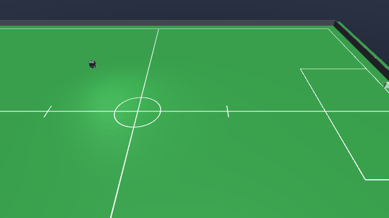

# GoToBall-v0



| | |
|---|---|
| Action Space | `Box(-1.0, 1.0, (7,), float32)` on the default tier 1, `Box(-1.0, 1.0, (6,), float32)` on tier 0 |
| Observation Space | `Box(-inf, inf, (14,), float32)` |
| import | `gym.make("GoToBall-v0")` |

## Description

One blue robot and a loose ball are dropped at random on an empty SSL Division A field.
The robot has to drive to the ball and stop with its dribbler mouth pointed at it — not
merely nearby, but oriented, because on this robot the kicker, the chipper and the dribbler
all live behind the same face and nothing can be done with a ball the robot is not facing.

This is the base skill the rest of the suite assumes. It is the only task in the set with a
closed-form solution — `mjsoccer.tasks.goto_ball_policy` is a P-controller that solves it —
which is what makes it useful as a smoke test: a task nobody can solve looks identical to a
working one until you try to train it. The kicker, chipper and dribbler are still in the
action space here, but the reward ignores them, so a policy is free to learn that leaving
them at rest costs the least energy.

## Action Space

The action is a `Box(-1, 1, (7,), float32)` on the default tier 1. Every element is
normalised and scaled internally by the actuator's own `ctrlrange`, so the physical bounds
below come from the model, not from a constant in the environment.

| Num | Action | Min | Max | Unit |
|---|---|---|---|---|
| 0 | wheel 1 speed (`wheel1_vel`) | -200 | 200 | rad/s |
| 1 | wheel 2 speed (`wheel2_vel`) | -200 | 200 | rad/s |
| 2 | wheel 3 speed (`wheel3_vel`) | -200 | 200 | rad/s |
| 3 | wheel 4 speed (`wheel4_vel`) | -200 | 200 | rad/s |
| 4 | kicker plunger force (`kicker_force`) | 0 | 500 | N, a one-step pulse for `6.5 * a` m/s when a > 0 |
| 5 | chipper plunger force (`chipper_force`) | 0 | 500 | N, a one-step pulse for `6.5 * a` m/s when a > 0 |
| 6 | dribbler bar speed (`dribbler_vel`) | 0 | 314 | rad/s |

On tier 0 the action is a `Box(-1, 1, (6,), float32)`: the four wheel servos are replaced by
the three chassis rows, and kicker, chipper and dribbler shift down to indices 3, 4 and 5.

| Num | Action | Min | Max | Unit |
|---|---|---|---|---|
| 0 | body-frame forward velocity (`vel_x`) | -4 | 4 | m/s |
| 1 | body-frame lateral velocity (`vel_y`) | -4 | 4 | m/s |
| 2 | yaw rate (`vel_yaw`) | -30 | 30 | rad/s |
| 3 | kicker plunger force (`kicker_force`) | 0 | 500 | N, a one-step pulse for `6.5 * a` m/s when a > 0 |
| 4 | chipper plunger force (`chipper_force`) | 0 | 500 | N, a one-step pulse for `6.5 * a` m/s when a > 0 |
| 5 | dribbler bar speed (`dribbler_vel`) | 0 | 314 | rad/s |

Rows 0-3 on tier 1 are wheel speeds written straight to the servos; what the chassis does
with them is left to the roller contacts, which can slip. Rows 0-2 on tier 0 are instead a
*body-frame* velocity that is rotated into the world-axis chassis slides before being
written, which is what makes the two tiers mean the same thing. The
kicker and chipper ask for a speed: `a <= 0` does not fire, `(0, 1]` sends the ball out at
`6.5 * a` m/s, and each shot locks that plunger out for 250 ms. The dribbler is
off for `a <= 0`, maps `(0, 1]` onto `(0, 314] rad/s` and is never driven backwards. See
[the action space contract](../index.md#action-space) for why each of those is the way it
is.

## Observation Space

`Box(-inf, inf, (14,), float32)`: 6 ball elements plus 8 for the single robot.

| Num | Observation | Min | Max | Name in XML / source | Unit |
|---|---|---|---|---|---|
| 0 | ball x position | -Inf | Inf | `ball` | m, / 6.0 (`FIELD_HALF_X`) |
| 1 | ball y position | -Inf | Inf | `ball` | m, / 4.5 (`FIELD_HALF_Y`) |
| 2 | ball height | -Inf | Inf | `ball` | m, / 0.155 (`GOAL_HEIGHT`) |
| 3 | ball x velocity | -Inf | Inf | `ball` | m/s, / 8.0 (`MAX_BALL_V`) |
| 4 | ball y velocity | -Inf | Inf | `ball` | m/s, / 8.0 (`MAX_BALL_V`) |
| 5 | ball z velocity | -Inf | Inf | `ball` | m/s, / 8.0 (`MAX_BALL_V`) |
| 6 | x position of the controlled blue robot | -Inf | Inf | `b0_robot` | m, / 6.0 (`FIELD_HALF_X`) |
| 7 | y position of the controlled blue robot | -Inf | Inf | `b0_robot` | m, / 4.5 (`FIELD_HALF_Y`) |
| 8 | sin of the yaw of the controlled blue robot | -1 | 1 | `b0_robot` | unitless |
| 9 | cos of the yaw of the controlled blue robot | -1 | 1 | `b0_robot` | unitless |
| 10 | world-frame x velocity of the controlled blue robot | -Inf | Inf | `b0_robot` | m/s, / 4.0 (`MAX_V`) |
| 11 | world-frame y velocity of the controlled blue robot | -Inf | Inf | `b0_robot` | m/s, / 4.0 (`MAX_V`) |
| 12 | yaw rate of the controlled blue robot | -Inf | Inf | `b0_robot` | rad/s, / 30.0 (`MAX_W`) |
| 13 | whether the controlled blue robot has the ball | 0 | 1 | `BaseEnv.holds` | 0 or 1 |

Positions and velocities are divided by the constants shown in the Unit column; yaw is
given as its sine and cosine so the wrap at +/-pi is not a discontinuity in the input. The
`Box` is declared unbounded because nothing clips these values.

## Rewards

Per step:

| term | value |
|---|---|
| approach shaping | `prev_dist - dist`, the decrease in robot-to-ball distance over the step |
| facing bonus | `+0.05 * cos(angle between the robot's front and the ball)` |
| energy | `-0.001 * ||a||^2` |
| arrival bonus | `+10.0` on the terminating step |

All shaping is potential-based: the approach term is the *decrease* in a distance over one
step, so the total shaping a policy can collect over an episode is bounded by the starting
distance (at most about 15 m across the diagonal of the field) and no cycle pays — driving
away and back nets zero.

The facing bonus is not potential-based; it is a bounded per-step term worth at most
`+0.05`, which over the 1250-step horizon is worth up to `+62.5` if the robot orbits the
ball while pointed at it. It is there because arrival requires `cos > 0.9` and pure distance
shaping gives no gradient towards orientation.

`ENERGY = 0.001` multiplies the squared norm of the whole flat action, so it now sums over
all 7 dimensions on the default tier 1 (6 on tier 0) rather than just the drive channels: a
saturated action costs `-0.007` per step on tier 1, `-0.006` on tier 0. It is enough to
discourage buzzing, including
pointless kicking and chipping, without meaningfully competing with the task reward.

## Starting State

`_place` rejection-samples two positions with `sample_pose`: one for the robot, one for the
ball. Each is uniform in `x` over `[-5.7, 5.7]` and `y` over `[-4.2, 4.2]` (a 0.3 m margin
inside the field), resampled until it is at least 0.5 m from everything already placed, up
to 200 attempts. The robot's yaw is uniform over `[-pi, pi)`. The ball starts at rest on the
floor; the robot starts at rest at the chassis height the model defines.

`_reset_task` records the initial robot-to-ball distance as the shaping baseline.

## Episode End

### Termination

- **Success.** The robot is within `REACH = 0.13 m` of the ball *and* facing it with
  `cos > 0.9`. `REACH` is a little past the 90 mm chassis radius: the ball sits about 94 mm
  out from the chassis centre when the dribbler holds it.
- **Ball out of the field.** `scene.in_field` fails for the ball centre, i.e. `|x| > 6.0 m`
  or `|y| > 4.5 m`. `info["ball_out"]` is set. This env never sets `info["goal"]`, so a ball
  crossing the goal line counts as out here.
- **Controlled robot turned over.** The robot's own +z tilts more than 60 deg off world
  +z (`cos < 0.5`). The step pays `-100.0` on top of whatever the task scored and
  `info["tipped"]` is set. Only the robots the policy controls count — a scripted robot on
  its side is the agent's to exploit. Tier 0 never trips this: its chassis is a planar
  joint and cannot leave the ground.
- **Diverged simulation.** If `qpos` or `qvel` stops being finite, `step` raises
  `RuntimeError` rather than returning a NaN observation to train on. This is an error, not
  a normal termination.

### Truncation

`steps >= max_steps`, where `max_steps = round(horizon_s / dt)`. The default horizon is
**20 s**, and at the default `control_hz=60` the actual `dt` is 0.016 s, so **1250 steps**.

## Arguments

| parameter | type | default | description |
|---|---|---|---|
| `tier` | `int` | `1` | `1` = roller wheels with real slip, the default; `0` = the faster kinematic chassis |
| `control_hz` | `int` | `60` | requested control rate; rounded to a whole number of 2 ms physics steps, so 60 becomes 62.5 Hz |
| `horizon_s` | `float` | `20.0` | truncation horizon, in seconds |
| `render_mode` | `str \| None` | `None` | `"human"` or `"rgb_array"` |

```python
import gymnasium as gym
import mjsoccer

env = gym.make("GoToBall-v0", tier=0, control_hz=60, horizon_s=20.0, render_mode="rgb_array")
```

## Info dictionary

| key | type | description |
|---|---|---|
| `is_success` | `bool` | the robot arrived at the ball facing it |
| `dist` | `float` | robot-to-ball distance in metres after this step |
| `ball_out` | `bool` | present only on the step the ball leaves the field |
| `tipped` | `bool` | present only on the step a controlled robot turned over |
| `tilt_deg` | `float` | with `tipped`: the worst controlled robot's tilt off vertical, degrees |
| `tip_step` | `int` | with `tipped`: control steps since reset, so time-to-tip is `tip_step * dt` |

## Version History

- v0: initial release.
