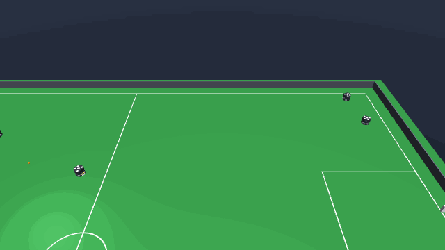

# GoToBall-v0



| | |
|---|---|
| Action Space | `Box(-1.0, 1.0, (7,), float32)` |
| Observation Space | `Box((62,), float32)`, bounded per row below |
| import | `gym.make("GoToBall-v0")` |

## Description

One blue robot, a loose ball and six parked yellow robots are dropped at random on the
SSL Division A field. The robot has to get its centre within 0.2 m of the ball; facing does
not matter. This is rSoccer's `SSLGoToBall-v0` (`kwargs={'field_type': 2, 'n_robots_yellow': 6}`):
the yellow robots get no commands and are only in the way.

It is the one task with a closed-form solution — `mjsoccer.tasks.goto_ball_policy` is a
P-controller that solves it — which makes it the smoke test of the suite. The kicker, chipper
and dribbler are in the action space but the reward ignores them.

## Action Space

The action is a `Box(-1, 1, (7,), float32)`. Every element is
normalised: the target pose is scaled by the half field, and kick, chip and dribble by
their actuators' own `ctrlrange`.

| Num | Action | Min | Max | Unit |
|---|---|---|---|---|
| 0 | target x | -6.0 | 6.0 | m, `a * 6.0` (`FIELD_HALF_X`) |
| 1 | target y | -4.5 | 4.5 | m, `a * 4.5` (`FIELD_HALF_Y`) |
| 2 | sin of the target heading | -1 | 1 | heading `atan2(a_2, a_3)` |
| 3 | cos of the target heading | -1 | 1 | |
| 4 | kicker plunger force (`kicker_force`) | 0 | 500 | N, a one-step pulse for `6.5 * a` m/s when a > 0 |
| 5 | chipper plunger force (`chipper_force`) | 0 | 500 | N, a one-step pulse for `6.5 * a` m/s when a > 0 |
| 6 | dribbler bar speed (`dribbler_vel`) | 0 | 314 | rad/s |

Rows 0-3 are a target pose (target velocity 0) that the navigation controller turns into a body-frame velocity every 25 ms control step
(see the index). The kicker and chipper ask for a speed: `a <= 0` does not fire, `(0, 1]` sends the ball out at
`6.5 * a` m/s, and each shot locks that plunger out for 250 ms. The dribbler is
off for `a <= 0`, maps `(0, 1]` onto `(0, 314] rad/s` and is never driven backwards. See
[the action space contract](../index.md#action-space) for why each of those is the way it
is.

## Observation Space

`Box((62,), float32)`: 6 ball elements plus 8 for each of the 7 robots, the controlled blue
robot first and then the six yellow ones, laid out exactly as in
[`StaticDefenders-v0`](static_defenders.md#observation-space).

## Rewards

rSoccer's, sparse: `+1.0` on the step the robot-to-ball distance (centre to centre) drops
under 0.2 m, which also ends the episode, and `0` on every other step. No shaping, no facing,
no energy, no penalties.

## Starting State

rSoccer's layout. The ball is uniform over the field less a 0.1 m margin (`x` in
`[-5.9, 5.9]`, `y` in `[-4.4, 4.4]`). The blue robot, then the six yellow ones, are drawn from
the same box, each resampled until it is at least 0.2 m (centre to centre) from everything
already placed, with yaw uniform over `[0, 2 pi)`. Everything starts at rest.

## Episode End

### Termination

- **Success.** Robot-to-ball distance under 0.2 m: `+1.0`.
- **Diverged simulation.** If `qpos` or `qvel` stops being finite, `step` raises
  `RuntimeError` rather than returning a NaN observation to train on.

### Truncation

`steps >= max_steps`, where `max_steps = round(horizon_s / dt)`. The default horizon is
**30 s**, rSoccer's: **1200 control steps** at the fixed 40 Hz (0.025 s), rSoccer's step.

## Arguments

| parameter | type | default | description |
|---|---|---|---|
| `repeat_action` | `int` | `1` | control steps (25 ms each, fixed 40 Hz) one decision is held for |
| `horizon_s` | `float` | `30.0` | truncation horizon, in seconds |
| `render_mode` | `str \| None` | `None` | `"human"` or `"rgb_array"` |

```python
import gymnasium as gym
import mjsoccer

env = gym.make("GoToBall-v0", horizon_s=30.0, render_mode="rgb_array")
```

## Info dictionary

| key | type | description |
|---|---|---|
| `is_success` | `bool` | the robot got within 0.2 m of the ball |
| `dist` | `float` | robot-to-ball distance in metres after this step |

## Version History

- v0: initial release.
