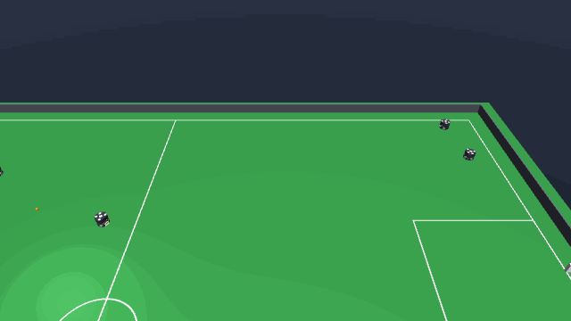

# GoToBall-v0



| | |
|---|---|
| Action Space | `Box(-1.0, 1.0, (7,), float32)` |
| Observation Space | `Box((62,), float32)`, bounded per row below |
| import | `gym.make("GoToBall-v0")` |

## Description

One blue robot, a loose ball and six parked yellow robots are dropped at random on the
SSL Division A field. The robot has to get its centre within 0.2 m of the ball; facing does
not matter. This is rSoccer's `SSLGoToBall-v0` (`kwargs={'field_type': 2, 'n_robots_yellow': 6}`):
the yellow robots get no commands and are only in the way.

It is the one task with a closed-form solution, which makes it the smoke test of the suite:
`mjsoccer.tasks.goto_ball_policy` outputs a target pose (the ball's position, heading towards
the ball) and the navigation controller does the control. The kicker, chipper and dribbler
are in the action space but the reward ignores them.

## Action Space

The action is a `Box(-1, 1, (7,), float32)` and drives the blue robot only; the yellow robots are
not controllable and never appear in it.

| Num | Action | Min | Max | Unit |
|---|---|---|---|---|
| 0 | target x | -6.0 | 6.0 | m, `a * 6.0` (`FIELD_HALF_X`) |
| 1 | target y | -4.5 | 4.5 | m, `a * 4.5` (`FIELD_HALF_Y`) |
| 2 | sin of the target heading | -1 | 1 | heading `atan2(a_2, a_3)` |
| 3 | cos of the target heading | -1 | 1 | |
| 4 | kick speed (`kicker_force`) | 0 | 6.5 | m/s, `6.5 * a` for `a > 0`; `a <= 0` does not fire |
| 5 | chip speed (`chipper_force`) | 0 | 6.5 | m/s, `6.5 * a` for `a > 0`; `a <= 0` does not fire |
| 6 | dribbler bar speed (`dribbler_vel`) | 0 | 314 | rad/s, `314 * max(a, 0)` (`DRIBBLER_OMEGA`) |

Rows 0-3 are a target pose (target velocity 0) that the navigation controller turns into a
body-frame velocity every 25 ms control step. Rows 4-5 ask for a ball speed, not a force:
`KICK_TABLE_MS` maps `6.5 * a` m/s to a one-step plunger force (`a = 1` lands at ~295-315 N;
the actuators' `ctrlrange` is 0..500 N). Each shot locks that plunger out for 250 ms; the
kicker and chipper locks are independent, so a kick cannot block a chip. Row 6 is off for
`a <= 0` and never drives the bar backwards (its `ctrlrange` is +-1500 rad/s; the action uses
only 0..314). See [the action space contract](../index.md#action-space).

## Observation Space

`Box((62,), float32)`: 6 ball elements plus 8 for each of the 7 robots, the controlled
blue robot first and then the six yellow ones.

| Num | Observation | Min | Max | Name in XML / source | Unit |
|---|---|---|---|---|---|
| 0 | ball x position | -Inf | Inf | `ball` | m, / 6.0 (`FIELD_HALF_X`) |
| 1 | ball y position | -Inf | Inf | `ball` | m, / 4.5 (`FIELD_HALF_Y`) |
| 2 | ball height above the carpet | 0 | Inf | `ball` | m, / 0.155 (`GOAL_HEIGHT`) |
| 3 | ball x velocity | -Inf | Inf | `ball` | m/s, / 8.0 (`MAX_BALL_V`) |
| 4 | ball y velocity | -Inf | Inf | `ball` | m/s, / 8.0 (`MAX_BALL_V`) |
| 5 | ball z velocity | -Inf | Inf | `ball` | m/s, / 8.0 (`MAX_BALL_V`) |
| 6 | x position of the controlled blue robot | -1.05 | 1.05 | `b0_robot` | m, / 6.0 (`FIELD_HALF_X`) |
| 7 | y position of the controlled blue robot | -1.067 | 1.067 | `b0_robot` | m, / 4.5 (`FIELD_HALF_Y`) |
| 8 | sin of the yaw of the controlled blue robot | -1 | 1 | `b0_robot` | unitless |
| 9 | cos of the yaw of the controlled blue robot | -1 | 1 | `b0_robot` | unitless |
| 10 | world-frame x velocity of the controlled blue robot | -Inf | Inf | `b0_robot` | m/s, / 3.3 (`MAX_V`) |
| 11 | world-frame y velocity of the controlled blue robot | -Inf | Inf | `b0_robot` | m/s, / 3.3 (`MAX_V`) |
| 12 | yaw rate of the controlled blue robot | -Inf | Inf | `b0_robot` | rad/s, / 37.1 (`MAX_W`) |
| 13 | whether the controlled blue robot has the ball | 0 | 1 | `BaseEnv.holds` | 0 or 1 |
| 14 | x position of yellow robot 0 | -1.05 | 1.05 | `y0_robot` | m, / 6.0 (`FIELD_HALF_X`) |
| 15 | y position of yellow robot 0 | -1.067 | 1.067 | `y0_robot` | m, / 4.5 (`FIELD_HALF_Y`) |
| 16 | sin of the yaw of yellow robot 0 | -1 | 1 | `y0_robot` | unitless |
| 17 | cos of the yaw of yellow robot 0 | -1 | 1 | `y0_robot` | unitless |
| 18 | world-frame x velocity of yellow robot 0 | -Inf | Inf | `y0_robot` | m/s, / 3.3 (`MAX_V`) |
| 19 | world-frame y velocity of yellow robot 0 | -Inf | Inf | `y0_robot` | m/s, / 3.3 (`MAX_V`) |
| 20 | yaw rate of yellow robot 0 | -Inf | Inf | `y0_robot` | rad/s, / 37.1 (`MAX_W`) |
| 21 | whether yellow robot 0 has the ball | 0 | 1 | `BaseEnv.holds` | 0 or 1 |
| 22 | x position of yellow robot 1 | -1.05 | 1.05 | `y1_robot` | m, / 6.0 (`FIELD_HALF_X`) |
| 23 | y position of yellow robot 1 | -1.067 | 1.067 | `y1_robot` | m, / 4.5 (`FIELD_HALF_Y`) |
| 24 | sin of the yaw of yellow robot 1 | -1 | 1 | `y1_robot` | unitless |
| 25 | cos of the yaw of yellow robot 1 | -1 | 1 | `y1_robot` | unitless |
| 26 | world-frame x velocity of yellow robot 1 | -Inf | Inf | `y1_robot` | m/s, / 3.3 (`MAX_V`) |
| 27 | world-frame y velocity of yellow robot 1 | -Inf | Inf | `y1_robot` | m/s, / 3.3 (`MAX_V`) |
| 28 | yaw rate of yellow robot 1 | -Inf | Inf | `y1_robot` | rad/s, / 37.1 (`MAX_W`) |
| 29 | whether yellow robot 1 has the ball | 0 | 1 | `BaseEnv.holds` | 0 or 1 |
| 30 | x position of yellow robot 2 | -1.05 | 1.05 | `y2_robot` | m, / 6.0 (`FIELD_HALF_X`) |
| 31 | y position of yellow robot 2 | -1.067 | 1.067 | `y2_robot` | m, / 4.5 (`FIELD_HALF_Y`) |
| 32 | sin of the yaw of yellow robot 2 | -1 | 1 | `y2_robot` | unitless |
| 33 | cos of the yaw of yellow robot 2 | -1 | 1 | `y2_robot` | unitless |
| 34 | world-frame x velocity of yellow robot 2 | -Inf | Inf | `y2_robot` | m/s, / 3.3 (`MAX_V`) |
| 35 | world-frame y velocity of yellow robot 2 | -Inf | Inf | `y2_robot` | m/s, / 3.3 (`MAX_V`) |
| 36 | yaw rate of yellow robot 2 | -Inf | Inf | `y2_robot` | rad/s, / 37.1 (`MAX_W`) |
| 37 | whether yellow robot 2 has the ball | 0 | 1 | `BaseEnv.holds` | 0 or 1 |
| 38 | x position of yellow robot 3 | -1.05 | 1.05 | `y3_robot` | m, / 6.0 (`FIELD_HALF_X`) |
| 39 | y position of yellow robot 3 | -1.067 | 1.067 | `y3_robot` | m, / 4.5 (`FIELD_HALF_Y`) |
| 40 | sin of the yaw of yellow robot 3 | -1 | 1 | `y3_robot` | unitless |
| 41 | cos of the yaw of yellow robot 3 | -1 | 1 | `y3_robot` | unitless |
| 42 | world-frame x velocity of yellow robot 3 | -Inf | Inf | `y3_robot` | m/s, / 3.3 (`MAX_V`) |
| 43 | world-frame y velocity of yellow robot 3 | -Inf | Inf | `y3_robot` | m/s, / 3.3 (`MAX_V`) |
| 44 | yaw rate of yellow robot 3 | -Inf | Inf | `y3_robot` | rad/s, / 37.1 (`MAX_W`) |
| 45 | whether yellow robot 3 has the ball | 0 | 1 | `BaseEnv.holds` | 0 or 1 |
| 46 | x position of yellow robot 4 | -1.05 | 1.05 | `y4_robot` | m, / 6.0 (`FIELD_HALF_X`) |
| 47 | y position of yellow robot 4 | -1.067 | 1.067 | `y4_robot` | m, / 4.5 (`FIELD_HALF_Y`) |
| 48 | sin of the yaw of yellow robot 4 | -1 | 1 | `y4_robot` | unitless |
| 49 | cos of the yaw of yellow robot 4 | -1 | 1 | `y4_robot` | unitless |
| 50 | world-frame x velocity of yellow robot 4 | -Inf | Inf | `y4_robot` | m/s, / 3.3 (`MAX_V`) |
| 51 | world-frame y velocity of yellow robot 4 | -Inf | Inf | `y4_robot` | m/s, / 3.3 (`MAX_V`) |
| 52 | yaw rate of yellow robot 4 | -Inf | Inf | `y4_robot` | rad/s, / 37.1 (`MAX_W`) |
| 53 | whether yellow robot 4 has the ball | 0 | 1 | `BaseEnv.holds` | 0 or 1 |
| 54 | x position of yellow robot 5 | -1.05 | 1.05 | `y5_robot` | m, / 6.0 (`FIELD_HALF_X`) |
| 55 | y position of yellow robot 5 | -1.067 | 1.067 | `y5_robot` | m, / 4.5 (`FIELD_HALF_Y`) |
| 56 | sin of the yaw of yellow robot 5 | -1 | 1 | `y5_robot` | unitless |
| 57 | cos of the yaw of yellow robot 5 | -1 | 1 | `y5_robot` | unitless |
| 58 | world-frame x velocity of yellow robot 5 | -Inf | Inf | `y5_robot` | m/s, / 3.3 (`MAX_V`) |
| 59 | world-frame y velocity of yellow robot 5 | -Inf | Inf | `y5_robot` | m/s, / 3.3 (`MAX_V`) |
| 60 | yaw rate of yellow robot 5 | -Inf | Inf | `y5_robot` | rad/s, / 37.1 (`MAX_W`) |
| 61 | whether yellow robot 5 has the ball | 0 | 1 | `BaseEnv.holds` | 0 or 1 |

Positions and velocities are divided by the constants in the Unit column; yaw is given as
its sine and cosine so the wrap at +-pi is not a discontinuity. Ball height is measured from
the carpet and normalised by `GOAL_HEIGHT = 0.155 m`, so a chipped ball reads greater than 1
exactly when it is too high to score. Only robot position, yaw and `has_ball` are bounded:
nothing clips, so a bound exists only where the field walls guarantee it.

The yellow robots get no commands: their pose entries change only when something pushes
them, and their velocity entries are zero otherwise.

## Rewards

rSoccer's, sparse.

| term | value |
|---|---|
| reached | `+1.0` on the step the robot-to-ball distance (centre to centre) drops under 0.2 m; ends the episode |

Every other step pays `0`. No shaping, no facing, no energy, no penalties.

## Starting State

rSoccer's layout. The ball is uniform over the field less a 0.1 m margin (`x` in
`[-5.9, 5.9]`, `y` in `[-4.4, 4.4]`). The blue robot, then the six yellow ones, are drawn from
the same box, each resampled until it is at least 0.2 m (centre to centre) from everything
already placed, with yaw uniform over `[0, 2 pi)`. Everything starts at rest.
(GPU backends: the first clear draw out of a fixed candidate set (8 per robot); if none is clear, the roomiest one, flagged `reset_overlap`. See [the backends](../backends/index.md).)

## Episode End

### Termination

One condition, plus divergence:

- **Success.** Robot-to-ball distance under 0.2 m: `+1.0`, `info["is_success"]`.
- **Diverged simulation.** If `qpos` or `qvel` stops being finite, `step` raises
  `RuntimeError` rather than returning a NaN observation to train on. (GPU backends end that
  world with obs and reward 0, count it in `diverged` and auto-reset; see [the backends](../backends/index.md).)

### Truncation

`steps >= max_steps`, where `max_steps = round(horizon_s / dt)`. The default horizon is
**30 s**, rSoccer's: **1200 control steps** at the fixed 40 Hz (0.025 s), rSoccer's step.

## Arguments

| parameter | type | default | description |
|---|---|---|---|
| `repeat_action` | `int` | `1` | control steps (25 ms each, fixed 40 Hz) one decision is held for |
| `horizon_s` | `float` | `30.0` | truncation horizon, in seconds |
| `render_mode` | `str \| None` | `None` | `"human"` or `"rgb_array"` |
| `viewer_gfx` | `str` | `"opengl_headless"` | how `"human"` mode draws: `"opengl_headless"` or `"web"` |

```python
import gymnasium as gym
import mjsoccer

env = gym.make("GoToBall-v0", horizon_s=30.0, render_mode="rgb_array")
```

`n_yellow` (6) is a class attribute on `GoToBallEnv`, not a `gym.make` keyword; it determines the compiled model, and therefore the observation size. The GPU backends read it off the CPU class.

## Info dictionary

| key | type | description |
|---|---|---|
| `is_success` | `bool` | the robot got within 0.2 m of the ball |
| `dist` | `float` | robot-to-ball distance in metres after this step |

These keys are returned by the CPU (Gymnasium) env only; the GPU backends do not return them. See [the backends](../backends/index.md).

## Version History

- v0: initial release.
