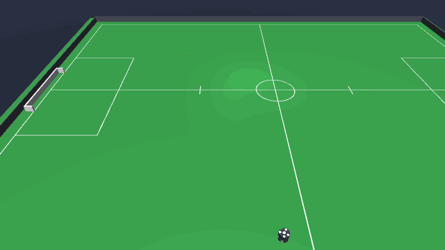

# GoToBallShoot-v0



| | |
|---|---|
| Action Space | `Box(-1.0, 1.0, (7,), float32)` on the default tier 1, `Box(-1.0, 1.0, (6,), float32)` on tier 0 |
| Observation Space | `Box((14,), float32)`, bounded per row below |
| import | `gym.make("GoToBallShoot-v0")` |

## Description

One blue robot starts on its own half with a loose ball somewhere on the field, and has to
put the ball in the goal at `x = +6.0`. There is nothing in the way: no keeper, no
defenders, no opponent.

The task exists to close the loop between locomotion and the ball-handling mechanisms.
`GoToBall-v0` ends the moment the robot is in position; here that is only the first half of
the episode, and the reward keeps paying only for what happens to the *ball* afterwards.
The robot can dribble the ball down the field, shove it with the chassis, kick it flat or
chip it — every one of those is in the action space and none of them is privileged by the
reward, which cares only that the ball ends up past the goal line, inside the mouth and
under the crossbar.

`StaticDefenders-v0` is this task with six parked yellow robots between the ball and the
goal; the reward and termination there are identical.

## Action Space

The action is a `Box(-1, 1, (7,), float32)` on the default tier 1. Every element is
normalised and scaled internally by the actuator's own `ctrlrange`, so the physical bounds
below come from the model, not from a constant in the environment.

| Num | Action | Min | Max | Unit |
|---|---|---|---|---|
| 0 | wheel 1 speed (`wheel1_vel`) | -95 | 95 | rad/s |
| 1 | wheel 2 speed (`wheel2_vel`) | -95 | 95 | rad/s |
| 2 | wheel 3 speed (`wheel3_vel`) | -95 | 95 | rad/s |
| 3 | wheel 4 speed (`wheel4_vel`) | -95 | 95 | rad/s |
| 4 | kicker plunger force (`kicker_force`) | 0 | 500 | N, a one-step pulse for `6.5 * a` m/s when a > 0 |
| 5 | chipper plunger force (`chipper_force`) | 0 | 500 | N, a one-step pulse for `6.5 * a` m/s when a > 0 |
| 6 | dribbler bar speed (`dribbler_vel`) | 0 | 314 | rad/s |

On tier 0 the action is a `Box(-1, 1, (6,), float32)`: the four wheel servos are replaced by
the three chassis rows, and kicker, chipper and dribbler shift down to indices 3, 4 and 5.

| Num | Action | Min | Max | Unit |
|---|---|---|---|---|
| 0 | body-frame forward velocity (`vel_x`) | -4 | 4 | m/s |
| 1 | body-frame lateral velocity (`vel_y`) | -4 | 4 | m/s |
| 2 | yaw rate (`vel_yaw`) | -30 | 30 | rad/s |
| 3 | kicker plunger force (`kicker_force`) | 0 | 500 | N, a one-step pulse for `6.5 * a` m/s when a > 0 |
| 4 | chipper plunger force (`chipper_force`) | 0 | 500 | N, a one-step pulse for `6.5 * a` m/s when a > 0 |
| 5 | dribbler bar speed (`dribbler_vel`) | 0 | 314 | rad/s |

Rows 0-3 on tier 1 are wheel speeds written straight to the servos, and the roller contacts
decide what the chassis does with them. Rows 0-2 on tier 0 are instead a *body-frame*
velocity that is rotated into the world-axis chassis
slides before being written. The kicker and chipper ask for a speed: `a <= 0` does not
fire, `(0, 1]` sends the ball out at `6.5 * a` m/s, and each shot locks that plunger out for
250 ms — the two locks are independent, so a kick cannot block a chip. The dribbler is off for `a <= 0`, maps `(0, 1]` onto `(0, 314] rad/s`,
and is never driven backwards. See [the action space contract](../index.md#action-space) for the
reasoning behind each.

## Observation Space

`Box((14,), float32)`, bounded per row below: 6 ball elements plus 8 for the single robot. Note that
the goal is not in the observation — it is at a fixed place on a fixed field, so its
position is a constant a policy can absorb into its weights.

| Num | Observation | Min | Max | Name in XML / source | Unit |
|---|---|---|---|---|---|
| 0 | ball x position | -Inf | Inf | `ball` | m, / 6.0 (`FIELD_HALF_X`) |
| 1 | ball y position | -Inf | Inf | `ball` | m, / 4.5 (`FIELD_HALF_Y`) |
| 2 | ball height above the carpet | 0 | Inf | `ball` | m, / 0.155 (`GOAL_HEIGHT`) |
| 3 | ball x velocity | -Inf | Inf | `ball` | m/s, / 8.0 (`MAX_BALL_V`) |
| 4 | ball y velocity | -Inf | Inf | `ball` | m/s, / 8.0 (`MAX_BALL_V`) |
| 5 | ball z velocity | -Inf | Inf | `ball` | m/s, / 8.0 (`MAX_BALL_V`) |
| 6 | x position of the controlled blue robot | -1.05 | 1.05 | `b0_robot` | m, / 6.0 (`FIELD_HALF_X`) |
| 7 | y position of the controlled blue robot | -1.067 | 1.067 | `b0_robot` | m, / 4.5 (`FIELD_HALF_Y`) |
| 8 | sin of the yaw of the controlled blue robot | -1 | 1 | `b0_robot` | unitless |
| 9 | cos of the yaw of the controlled blue robot | -1 | 1 | `b0_robot` | unitless |
| 10 | world-frame x velocity of the controlled blue robot | -Inf | Inf | `b0_robot` | m/s, / 3.3 (`MAX_V`) |
| 11 | world-frame y velocity of the controlled blue robot | -Inf | Inf | `b0_robot` | m/s, / 3.3 (`MAX_V`) |
| 12 | yaw rate of the controlled blue robot | -Inf | Inf | `b0_robot` | rad/s, / 37.1 (`MAX_W`) |
| 13 | whether the controlled blue robot has the ball | 0 | 1 | `BaseEnv.holds` | 0 or 1 |

Positions and velocities are divided by the constants shown in the Unit column; yaw is
given as its sine and cosine so the wrap at +/-pi is not a discontinuity in the input. Ball
height is measured from the carpet and normalised by `GOAL_HEIGHT = 0.155 m`, which makes a chipped ball read greater
than 1 exactly when it is too high to score.

## Rewards

Per step:

| term | value |
|---|---|
| approach shaping | `prev_dist - dist` while `not has_kicked`, the decrease in robot-to-ball distance |
| goal shaping | `prev_goal_dist - goal_dist` once `has_kicked`, the decrease in ball-to-goal distance |
| facing | `0.5 * (cos - prev_cos)`, the change in cos(angle between the robot's front and robot->ball) |
| energy | `-0.01 * ||a||^2` |
| goal bonus | `+10.0` on the terminating step |
| ball out | `-10.0` on the terminating step |

`goal_dist` is the 2-D distance from the ball to the nearest point of the goal mouth,
`(6.0, clip(ball_y, -0.9, 0.9))`. `has_kicked` latches the first time the kicker or chipper fires while the robot is at the ball (within `REACH = 0.13 m` and facing it with `cos > 0.9`, judged on the state the action was taken in). A plunger fired at nothing does not count, or random exploration would spend it on the first step. One kick per episode: after a miss, nothing pays the robot to go back.

Facing is the change in a potential, so parking pays nothing and the bonus and fouls can stay at 10 next to the shaping. A raw per-step `0.1 * cos` with a `+100` bonus paid ~10-12 an episode for parking and SAC never approached the ball (`.scratch/rl-learning/issues/01-why-nothing-learns.md`); `test_kick_tasks_do_not_pay_camping` pins it.

`ENERGY = 0.01` multiplies the squared norm of the whole flat action (7 dimensions on tier 1, 6 on tier 0), so a saturated action costs `-0.07` / `-0.06` per step.

## Starting State

`_place` puts the robot on the defending half so that shooting means covering ground: `x`
uniform in `[-5.7, 0.0]`, `y` uniform in `[-4.2, 4.2]`, yaw uniform in `[-pi, pi)`. The ball
is then rejection-sampled with `sample_pose` anywhere in the field inside a 0.3 m margin,
resampled until it is at least 0.5 m from the robot, up to 200 attempts. The ball starts at
rest on the floor.

`_reset_task` records both baselines: the initial robot-to-ball distance and the initial
ball-to-goal distance.

## Episode End

### Termination

- **Goal.** `scene.in_goal(ball)`: the ball centre is past `x = 6.0`, inside the mouth
  (`|y| < 0.9`) and under the crossbar (`z - FLOOR_Z < 0.155`, centre height above the carpet). `info["goal"]` is `True`.
- **Ball out of the field.** `scene.in_field` fails for the ball centre (`|x| > 6.0 m` or
  `|y| > 4.5 m`) *and* `info["goal"]` is false, so a scored ball is never also reported as
  out. `info["ball_out"]` is set and the step pays `-10.0`. A shot that crosses the goal line
  wide, or over the crossbar, ends the episode as a miss.
- **Controlled robot turned over.** The robot's own +z tilts more than 60 deg off world
  +z (`cos < 0.5`). The step pays `-100.0` on top of whatever the task scored and
  `info["tipped"]` is set. Only the robots the policy controls count — a scripted robot on
  its side is the agent's to exploit. Tier 0 never trips this: its chassis is a planar
  joint and cannot leave the ground.
- **Diverged simulation.** If `qpos` or `qvel` stops being finite, `step` raises
  `RuntimeError` rather than returning a NaN observation to train on. This is an error, not
  a normal termination.

### Truncation

`steps >= max_steps`, where `max_steps = round(horizon_s / dt)`. The default horizon is
**12 s**, and at the default `control_hz=60` `dt` is exactly 1/60 s, so **720 steps** (180 at 15 Hz).

## Arguments

| parameter | type | default | description |
|---|---|---|---|
| `tier` | `int` | `1` | `1` = roller wheels with real slip, the default; `0` = the faster kinematic chassis |
| `control_hz` | `int` | `60` | control rate, exact: it must divide the 960 Hz physics rate (30, 60, 120, ...), or the env raises `ValueError` |
| `horizon_s` | `float` | `30.0` | truncation horizon, in seconds |
| `render_mode` | `str \| None` | `None` | `"human"` or `"rgb_array"` |

```python
import gymnasium as gym
import mjsoccer

env = gym.make("GoToBallShoot-v0", tier=0, control_hz=60, horizon_s=30.0, render_mode="rgb_array")
```

## Info dictionary

| key | type | description |
|---|---|---|
| `is_success` | `bool` | the ball ended up in the goal |
| `goal` | `bool` | the same flag; also read by `base.step` to keep a scored ball from being reported as out of the field |
| `ball_out` | `bool` | present only on the step the ball leaves the field without scoring |
| `tipped` | `bool` | present only on the step a controlled robot turned over |
| `tilt_deg` | `float` | with `tipped`: the worst controlled robot's tilt off vertical, degrees |
| `tip_step` | `int` | with `tipped`: control steps since reset, so time-to-tip is `tip_step * dt` |

## Version History

- v0: initial release.
