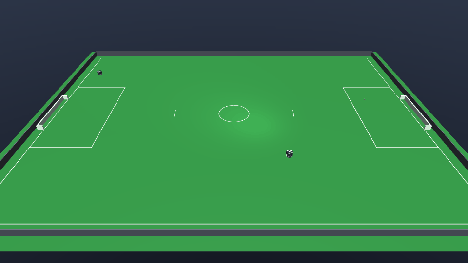

# PassEndurance-v0



| | |
|---|---|
| Action Space | `Box(-1.0, 1.0, (7,), float32)` on the default tier 1, `Box(-1.0, 1.0, (6,), float32)` on tier 0 |
| Observation Space | `Box(-inf, inf, (22,), float32)` |
| import | `gym.make("PassEndurance-v0")` |

## Description

Two blue robots and a loose ball. The agent controls the first one; the second stands still
with its dribbler running and faces the agent. The episode ends when the team-mate receives
the ball.

The task is the two-robot half of the suite. It is the only environment where success is
measured on a robot the policy does not control, which makes it the only one where the
agent has to aim: getting the ball is worth relatively little, and the reward is dominated
by how much closer the *ball* gets to the team-mate. A pass can be kicked flat, chipped
over, dribbled all the way there and handed off, or simply shoved with the chassis — nothing
in the reward privileges any of them, only the ball arriving.

The receiver is placed facing the passer, because a dribbler only catches a ball that
arrives at its mouth; a robot facing away is not a receiver at all. It never moves under its
own power — the only thing `_script` writes is its dribbler speed — so the difficulty scales
with the passing distance drawn at reset rather than with anything the receiver does.
Despite the name, one episode is one pass; the endurance is across episodes.

## Action Space

The action is a `Box(-1, 1, (7,), float32)` on the default tier 1 and drives the passer
only. The team-mate is scripted and never appears in the action, which is why the action is
7 wide even though the model contains two robots.

| Num | Action | Min | Max | Unit |
|---|---|---|---|---|
| 0 | wheel 1 speed (`wheel1_vel`) | -200 | 200 | rad/s |
| 1 | wheel 2 speed (`wheel2_vel`) | -200 | 200 | rad/s |
| 2 | wheel 3 speed (`wheel3_vel`) | -200 | 200 | rad/s |
| 3 | wheel 4 speed (`wheel4_vel`) | -200 | 200 | rad/s |
| 4 | kicker plunger force (`kicker_force`) | 0 | 500 | N, a one-step pulse for `6.5 * a` m/s when a > 0 |
| 5 | chipper plunger force (`chipper_force`) | 0 | 500 | N, a one-step pulse for `6.5 * a` m/s when a > 0 |
| 6 | dribbler bar speed (`dribbler_vel`) | 0 | 314 | rad/s |

On tier 0 the action is a `Box(-1, 1, (6,), float32)`, 6 wide for the same reason: the four
wheel servos are replaced by the three chassis rows, and kicker, chipper and dribbler shift
down to indices 3, 4 and 5.

| Num | Action | Min | Max | Unit |
|---|---|---|---|---|
| 0 | body-frame forward velocity (`vel_x`) | -4 | 4 | m/s |
| 1 | body-frame lateral velocity (`vel_y`) | -4 | 4 | m/s |
| 2 | yaw rate (`vel_yaw`) | -30 | 30 | rad/s |
| 3 | kicker plunger force (`kicker_force`) | 0 | 500 | N, a one-step pulse for `6.5 * a` m/s when a > 0 |
| 4 | chipper plunger force (`chipper_force`) | 0 | 500 | N, a one-step pulse for `6.5 * a` m/s when a > 0 |
| 5 | dribbler bar speed (`dribbler_vel`) | 0 | 314 | rad/s |

The kicker — row 4 on tier 1, row 3 on tier 0 — is the natural control for this task, and it
asks for a speed: `a in (0, 1]` sends the ball out at `6.5 * a` m/s, so pass strength is
the action, and `a <= 0` does not kick. Each shot locks that plunger out for 250 ms. The chipper is the alternative over an obstacle, though there
are no obstacles here. See [the action space contract](../index.md#action-space).

## Observation Space

`Box(-inf, inf, (22,), float32)`: 6 ball elements plus 8 for each of the 2 robots. Both
robots are blue, and they appear in attach order: the controlled passer first, the scripted
receiver second.

| Num | Observation | Min | Max | Name in XML / source | Unit |
|---|---|---|---|---|---|
| 0 | ball x position | -Inf | Inf | `ball` | m, / 6.0 (`FIELD_HALF_X`) |
| 1 | ball y position | -Inf | Inf | `ball` | m, / 4.5 (`FIELD_HALF_Y`) |
| 2 | ball height | -Inf | Inf | `ball` | m, / 0.155 (`GOAL_HEIGHT`) |
| 3 | ball x velocity | -Inf | Inf | `ball` | m/s, / 8.0 (`MAX_BALL_V`) |
| 4 | ball y velocity | -Inf | Inf | `ball` | m/s, / 8.0 (`MAX_BALL_V`) |
| 5 | ball z velocity | -Inf | Inf | `ball` | m/s, / 8.0 (`MAX_BALL_V`) |
| 6 | x position of the controlled blue robot | -Inf | Inf | `b0_robot` | m, / 6.0 (`FIELD_HALF_X`) |
| 7 | y position of the controlled blue robot | -Inf | Inf | `b0_robot` | m, / 4.5 (`FIELD_HALF_Y`) |
| 8 | sin of the yaw of the controlled blue robot | -1 | 1 | `b0_robot` | unitless |
| 9 | cos of the yaw of the controlled blue robot | -1 | 1 | `b0_robot` | unitless |
| 10 | world-frame x velocity of the controlled blue robot | -Inf | Inf | `b0_robot` | m/s, / 4.0 (`MAX_V`) |
| 11 | world-frame y velocity of the controlled blue robot | -Inf | Inf | `b0_robot` | m/s, / 4.0 (`MAX_V`) |
| 12 | yaw rate of the controlled blue robot | -Inf | Inf | `b0_robot` | rad/s, / 30.0 (`MAX_W`) |
| 13 | whether the controlled blue robot has the ball | 0 | 1 | `BaseEnv.holds` | 0 or 1 |
| 14 | x position of the blue team-mate (scripted) | -Inf | Inf | `b1_robot` | m, / 6.0 (`FIELD_HALF_X`) |
| 15 | y position of the blue team-mate (scripted) | -Inf | Inf | `b1_robot` | m, / 4.5 (`FIELD_HALF_Y`) |
| 16 | sin of the yaw of the blue team-mate (scripted) | -1 | 1 | `b1_robot` | unitless |
| 17 | cos of the yaw of the blue team-mate (scripted) | -1 | 1 | `b1_robot` | unitless |
| 18 | world-frame x velocity of the blue team-mate (scripted) | -Inf | Inf | `b1_robot` | m/s, / 4.0 (`MAX_V`) |
| 19 | world-frame y velocity of the blue team-mate (scripted) | -Inf | Inf | `b1_robot` | m/s, / 4.0 (`MAX_V`) |
| 20 | yaw rate of the blue team-mate (scripted) | -Inf | Inf | `b1_robot` | rad/s, / 30.0 (`MAX_W`) |
| 21 | whether the blue team-mate has the ball | 0 | 1 | `BaseEnv.holds` | 0 or 1 |

Elements 14 and 15 are the target of the pass — the only thing that varies between episodes
other than the passer's and the ball's start, since the receiver does not move. Elements 18
to 20 are zero unless the receiver has been hit. Element 21 is the termination condition
itself: the step it goes to 1 is the last step of the episode.

## Rewards

Per step:

| term | value |
|---|---|
| approach shaping | `0.2 * (prev_dist - dist)`, the decrease in passer-to-ball distance |
| pass shaping | `prev_mate_dist - mate_dist`, the decrease in ball-to-team-mate distance |
| energy | `-0.001 * ||a||^2` |
| reception bonus | `+10.0` on the terminating step |

Both shaping terms are potential-based — each is the *decrease* in a distance over one step
— so the total shaping over an episode is bounded by the starting distances and no cycle
pays. Fetching the ball and carrying it back nets exactly the geometry, not the effort.

The pass term is weighted five times the approach term for the same reason as in
`GoToBallShoot-v0`: moving the ball towards the receiver is the task, closing on the ball is
only how you get to do it. Note that the pass term is not gated on possession, so a ball
rolling towards the receiver after a kick keeps paying while it travels — which is the
intended behaviour for a task whose success condition is about the ball arriving, and is
bounded by the same telescoping sum as everything else.

`ENERGY = 0.001` multiplies the squared norm of the whole flat action, summing over all 7
dimensions on the default tier 1 (6 on tier 0), so a saturated action costs `-0.007` per
step on tier 1, `-0.006` on tier 0. A kick costs `0.001` on the step it fires, which is
negligible against a `+10`
reception.

## Starting State

`_place` draws three positions with `sample_pose`, each uniform in `x` over `[-5.7, 5.7]`
and `y` over `[-4.2, 4.2]` and rejection-sampled against everything already placed (up to
200 attempts each):

1. the passer, at a **1.5 m** clearance, with yaw uniform in `[-pi, pi)`;
2. the receiver, at a **1.5 m** clearance from the passer, with yaw set to
   `arctan2(passer_y - receiver_y, passer_x - receiver_x)` so it faces the passer — which is
   what makes a pass catchable at all;
3. the ball, at a **0.5 m** clearance from both robots, at rest on the floor.

So the pass is at least 1.5 m long, and the ball never starts already in the receiver's
mouth.

`_reset_task` records both baselines: the initial passer-to-ball distance and the initial
ball-to-receiver distance.

`_script` runs every step and writes `DRIBBLER_OMEGA` to the receiver's dribbler, so the
mouth is live for the whole episode. Nothing else about the receiver is driven: it has no
drive command, so it coasts if the ball or the passer hits it hard enough.

## Episode End

### Termination

- **Success.** `holds(1)` — the receiver's dribbler is in contact with the ball, subject to
  the usual 50 ms possession grace. Any arrival counts: a kicked pass, a chipped one, a ball
  dribbled up and handed over, or one shoved into the receiver with the chassis.
- **Ball out of the field.** `scene.in_field` fails for the ball centre (`|x| > 6.0 m` or
  `|y| > 4.5 m`); `info["ball_out"]` is set. This env never sets `info["goal"]`, so a
  mis-aimed kick that leaves the field ends the episode as a failure — which is the main
  risk of a full-power pass, since kick strength cannot be modulated.
- **Controlled robot turned over.** The robot's own +z tilts more than 60 deg off world
  +z (`cos < 0.5`). The step pays `-10.0` on top of whatever the task scored and
  `info["tipped"]` is set. Only the robots the policy controls count — a scripted robot on
  its side is the agent's to exploit. Tier 0 never trips this: its chassis is a planar
  joint and cannot leave the ground.
- **Diverged simulation.** If `qpos` or `qvel` stops being finite, `step` raises
  `RuntimeError` rather than returning a NaN observation to train on. This is an error, not
  a normal termination.

### Truncation

`steps >= max_steps`, where `max_steps = round(horizon_s / dt)`. The default horizon is
**20 s**, and at the default `control_hz=60` the actual `dt` is 0.016 s, so **1250 steps**.

## Arguments

| parameter | type | default | description |
|---|---|---|---|
| `tier` | `int` | `1` | `1` = roller wheels with real slip, the default; `0` = the faster kinematic chassis |
| `control_hz` | `int` | `60` | requested control rate; rounded to a whole number of 2 ms physics steps, so 60 becomes 62.5 Hz |
| `horizon_s` | `float` | `20.0` | truncation horizon, in seconds |
| `render_mode` | `str \| None` | `None` | `"human"` or `"rgb_array"` |

```python
import gymnasium as gym
import mjsoccer

env = gym.make("PassEndurance-v0", tier=0, control_hz=60, horizon_s=20.0, render_mode="rgb_array")
```

`n_blue` (2) is a class attribute on `PassEnduranceEnv`, not a `gym.make` keyword — it
determines the compiled model, and therefore the observation dimension. `n_controlled`
stays at 1, which is why adding the team-mate widens the observation by 8 but leaves the
action alone.

## Info dictionary

| key | type | description |
|---|---|---|
| `is_success` | `bool` | the team-mate received the ball |
| `ball_out` | `bool` | present only on the step the ball leaves the field |
| `tipped` | `bool` | present only on the step a controlled robot turned over |

## Version History

- v0: initial release.
