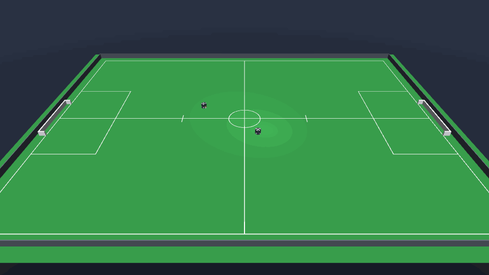

# PassEndurance-v0



| | |
|---|---|
| Action Space | `Box(-1.0, 1.0, (7,), float32)` |
| Observation Space | `Box((22,), float32)`, bounded per row below |
| import | `gym.make("PassEndurance-v0")` |

## Description

rSoccer's `SSLPassEndurance-v0`: the passer starts with the ball in its mouth and can only
turn, kick and dribble — it never translates. A stationary team-mate, dribbler running, faces
it from the other side of the line `y = 0`. The pass has to arrive: the episode pays +1 when
the receiver holds the ball, and -1 for a wrong ball.

The action space is still the shared one; the env reduces the passer's drive to a spin
(it zeroes `vx, vy` and keeps the yaw rate).

## Action Space

The action is a `Box(-1, 1, (7,), float32)` and drives the passer
only. The team-mate is scripted and never appears in the action, which is why the action is
7 wide even though the model contains two robots.

| Num | Action | Min | Max | Unit |
|---|---|---|---|---|
| 0 | target x | -6.0 | 6.0 | m, `a * 6.0` (`FIELD_HALF_X`) |
| 1 | target y | -4.5 | 4.5 | m, `a * 4.5` (`FIELD_HALF_Y`) |
| 2 | sin of the target heading | -1 | 1 | heading `atan2(a_2, a_3)` |
| 3 | cos of the target heading | -1 | 1 | |
| 4 | kicker plunger force (`kicker_force`) | 0 | 500 | N, a one-step pulse for `6.5 * a` m/s when a > 0 |
| 5 | chipper plunger force (`chipper_force`) | 0 | 500 | N, a one-step pulse for `6.5 * a` m/s when a > 0 |
| 6 | dribbler bar speed (`dribbler_vel`) | 0 | 314 | rad/s |

The passer cannot translate: the navigation controller runs whole and then its `vx, vy` go
to 0, so rows 0 and 1 are ignored and only the heading (rows 2-3) turns it.
The kicker — row 4 — is the natural control for this task, and it
asks for a speed: `a in (0, 1]` sends the ball out at `6.5 * a` m/s, so pass strength is
the action, and `a <= 0` does not kick. Each shot locks that plunger out for 250 ms. The chipper is the alternative over an obstacle, though there
are no obstacles here. See [the action space contract](../index.md#action-space).

## Observation Space

`Box((22,), float32)`, bounded per row below: 6 ball elements plus 8 for each of the 2 robots. Both
robots are blue, and they appear in attach order: the controlled passer first, the scripted
receiver second.

| Num | Observation | Min | Max | Name in XML / source | Unit |
|---|---|---|---|---|---|
| 0 | ball x position | -Inf | Inf | `ball` | m, / 6.0 (`FIELD_HALF_X`) |
| 1 | ball y position | -Inf | Inf | `ball` | m, / 4.5 (`FIELD_HALF_Y`) |
| 2 | ball height above the carpet | 0 | Inf | `ball` | m, / 0.155 (`GOAL_HEIGHT`) |
| 3 | ball x velocity | -Inf | Inf | `ball` | m/s, / 8.0 (`MAX_BALL_V`) |
| 4 | ball y velocity | -Inf | Inf | `ball` | m/s, / 8.0 (`MAX_BALL_V`) |
| 5 | ball z velocity | -Inf | Inf | `ball` | m/s, / 8.0 (`MAX_BALL_V`) |
| 6 | x position of the controlled blue robot | -1.05 | 1.05 | `b0_robot` | m, / 6.0 (`FIELD_HALF_X`) |
| 7 | y position of the controlled blue robot | -1.067 | 1.067 | `b0_robot` | m, / 4.5 (`FIELD_HALF_Y`) |
| 8 | sin of the yaw of the controlled blue robot | -1 | 1 | `b0_robot` | unitless |
| 9 | cos of the yaw of the controlled blue robot | -1 | 1 | `b0_robot` | unitless |
| 10 | world-frame x velocity of the controlled blue robot | -Inf | Inf | `b0_robot` | m/s, / 3.3 (`MAX_V`) |
| 11 | world-frame y velocity of the controlled blue robot | -Inf | Inf | `b0_robot` | m/s, / 3.3 (`MAX_V`) |
| 12 | yaw rate of the controlled blue robot | -Inf | Inf | `b0_robot` | rad/s, / 37.1 (`MAX_W`) |
| 13 | whether the controlled blue robot has the ball | 0 | 1 | `BaseEnv.holds` | 0 or 1 |
| 14 | x position of the blue team-mate (scripted) | -1.05 | 1.05 | `b1_robot` | m, / 6.0 (`FIELD_HALF_X`) |
| 15 | y position of the blue team-mate (scripted) | -1.067 | 1.067 | `b1_robot` | m, / 4.5 (`FIELD_HALF_Y`) |
| 16 | sin of the yaw of the blue team-mate (scripted) | -1 | 1 | `b1_robot` | unitless |
| 17 | cos of the yaw of the blue team-mate (scripted) | -1 | 1 | `b1_robot` | unitless |
| 18 | world-frame x velocity of the blue team-mate (scripted) | -Inf | Inf | `b1_robot` | m/s, / 3.3 (`MAX_V`) |
| 19 | world-frame y velocity of the blue team-mate (scripted) | -Inf | Inf | `b1_robot` | m/s, / 3.3 (`MAX_V`) |
| 20 | yaw rate of the blue team-mate (scripted) | -Inf | Inf | `b1_robot` | rad/s, / 37.1 (`MAX_W`) |
| 21 | whether the blue team-mate has the ball | 0 | 1 | `BaseEnv.holds` | 0 or 1 |

Elements 14 and 15 are the target of the pass — the only thing that varies between episodes
other than the passer's and the ball's start, since the receiver does not move. Elements 18
to 20 are zero unless the receiver has been hit. Element 21 is the termination condition
itself: the step it goes to 1 is the last step of the episode.

## Rewards

rSoccer's, per step:

| term | value |
|---|---|
| received | `+1.0` when the receiver holds the ball (`holds(1)`, rSoccer's infrared), and the episode ends |
| ball gradient | otherwise `clip(prev - now, -1, 1) / 1.875`, the ball closing on the receiver |
| wrong ball | `-1.0` added, and the episode ends, when the ball is outside the box the two robots span (positions truncated to whole centimetres, as rSoccer compares them), or its distance to the receiver has changed by under 0.01 m on more than 20 consecutive steps |

The stopped rule means the passer has about half a second (21 steps at 40 Hz) to kick.
rSoccer also ends on `holding_steps > 15`, but never increments it, so it is left out.

## Starting State

rSoccer's layout. The ball is uniform over `[-1.5, 1.5]^2`. The passer stands 0.115 m from it
on the side away from `y = 0`, facing it (yaw -90 deg for a ball at `y > 0`, +90 deg otherwise),
and `seat_ball` rolls the ball into its mouth. The receiver is at `(x, -ball_y)`, `x` uniform
over `[-1.5, 1.5]` redrawn until it is at least 1 m from the ball's `x`, facing the passer.

## Episode End

### Termination

- **Received.** The receiver holds the ball: `+1.0`, `info["is_success"]`.
- **Wrong ball.** Out of the passer-receiver box, or stopped for more than 20 steps: `-1.0`.
- **Diverged simulation.** If `qpos` or `qvel` stops being finite, `step` raises
  `RuntimeError` rather than returning a NaN observation to train on.

### Truncation

`steps >= max_steps`, where `max_steps = round(horizon_s / dt)`. The default horizon is
**30 s**, rSoccer's: **1200 control steps** at the fixed 40 Hz (0.025 s), rSoccer's step.

## Arguments

| parameter | type | default | description |
|---|---|---|---|
| `repeat_action` | `int` | `1` | control steps (25 ms each, fixed 40 Hz) one decision is held for |
| `horizon_s` | `float` | `30.0` | truncation horizon, in seconds |
| `render_mode` | `str \| None` | `None` | `"human"` or `"rgb_array"` |

```python
import gymnasium as gym
import mjsoccer

env = gym.make("PassEndurance-v0", horizon_s=30.0, render_mode="rgb_array")
```

`n_blue` (2) is a class attribute on `PassEnduranceEnv`, not a `gym.make` keyword — it
determines the compiled model, and therefore the observation dimension. `n_controlled`
stays at 1, which is why adding the team-mate widens the observation by 8 but leaves the
action alone.

## Info dictionary

| key | type | description |
|---|---|---|
| `is_success` | `bool` | the team-mate received the ball |

## Version History

- v0: initial release.
