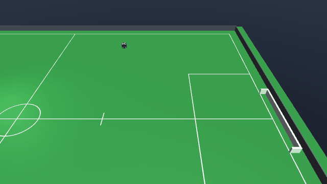

# StaticDefenders-v0



| | |
|---|---|
| Action Space | `Box(-1.0, 1.0, (7,), float32)` on the default tier 1, `Box(-1.0, 1.0, (6,), float32)` on tier 0 |
| Observation Space | `Box((62,), float32)`, bounded per row below |
| import | `gym.make("StaticDefenders-v0")` |

## Description

`StaticDefendersEnv` subclasses `GoToBallShootEnv`. The task, the reward and the
termination conditions are **identical** to
[`GoToBallShoot-v0`](go_to_ball_shoot.md) — score in the goal at `x = +6.0`. The only
differences are six stationary yellow robots parked in front of that goal and the
observation dimension that results from having seven robots in the model instead of one.

The defenders never move under their own power: the class overrides `_place` and nothing
else, so there is no `_script`, no drive command is ever written for them, and they only
shift if something hits them hard enough. They are an obstacle course, not an opponent.

The point is the geometry. The wall is staggered into two ranks specifically so that no
straight shot from the centre is free but the flanks stay open — a policy that has learned
to line up on the goal from `GoToBallShoot-v0` and fire will hit a robot, and has to learn
either to work the ball to a wing, to chip over the wall (a chipped ball only scores if it
is back under the 0.155 m crossbar by the time it crosses the line), or to carry the ball
around. It is also the largest model in the suite, which makes it the slowest to step: see
the [tier benchmark](../index.md#tiers).

## Action Space

Unchanged from every other environment in the suite. The action is a
`Box(-1, 1, (7,), float32)` on the default tier 1, driving the one blue robot; the six
yellow robots are not controllable and never appear in it. Every element is normalised and
scaled internally by the actuator's own `ctrlrange`.

| Num | Action | Min | Max | Unit |
|---|---|---|---|---|
| 0 | wheel 1 speed (`wheel1_vel`) | -200 | 200 | rad/s |
| 1 | wheel 2 speed (`wheel2_vel`) | -200 | 200 | rad/s |
| 2 | wheel 3 speed (`wheel3_vel`) | -200 | 200 | rad/s |
| 3 | wheel 4 speed (`wheel4_vel`) | -200 | 200 | rad/s |
| 4 | kicker plunger force (`kicker_force`) | 0 | 500 | N, a one-step pulse for `6.5 * a` m/s when a > 0 |
| 5 | chipper plunger force (`chipper_force`) | 0 | 500 | N, a one-step pulse for `6.5 * a` m/s when a > 0 |
| 6 | dribbler bar speed (`dribbler_vel`) | 0 | 314 | rad/s |

On tier 0 the action is a `Box(-1, 1, (6,), float32)`: the four wheel servos are replaced by
the three chassis rows, and kicker, chipper and dribbler shift down to indices 3, 4 and 5.

| Num | Action | Min | Max | Unit |
|---|---|---|---|---|
| 0 | body-frame forward velocity (`vel_x`) | -4 | 4 | m/s |
| 1 | body-frame lateral velocity (`vel_y`) | -4 | 4 | m/s |
| 2 | yaw rate (`vel_yaw`) | -30 | 30 | rad/s |
| 3 | kicker plunger force (`kicker_force`) | 0 | 500 | N, a one-step pulse for `6.5 * a` m/s when a > 0 |
| 4 | chipper plunger force (`chipper_force`) | 0 | 500 | N, a one-step pulse for `6.5 * a` m/s when a > 0 |
| 5 | dribbler bar speed (`dribbler_vel`) | 0 | 314 | rad/s |

The chipper (row 5 on the default tier 1, row 4 on tier 0) is the control this task exists
to motivate.
Like the kicker it asks for a speed: `a <= 0` does not fire, `(0, 1]` sends the ball out at
`6.5 * a` m/s, and each shot locks that plunger out for 250 ms. The two
locks are independent, so a kick cannot block a chip. See
[the action space contract](../index.md#action-space).

## Observation Space

`Box((62,), float32)`, bounded per row below: 6 ball elements plus 8 for each of the 7 robots. Robots
appear in attach order — the controlled blue robot first, then the six yellow ones, which
is the same ordering rule as everywhere else in the suite, so indices 0-13 mean exactly what
they mean in `GoToBallShoot-v0`.

| Num | Observation | Min | Max | Name in XML / source | Unit |
|---|---|---|---|---|---|
| 0 | ball x position | -Inf | Inf | `ball` | m, / 6.0 (`FIELD_HALF_X`) |
| 1 | ball y position | -Inf | Inf | `ball` | m, / 4.5 (`FIELD_HALF_Y`) |
| 2 | ball height above the carpet | 0 | Inf | `ball` | m, / 0.155 (`GOAL_HEIGHT`) |
| 3 | ball x velocity | -Inf | Inf | `ball` | m/s, / 8.0 (`MAX_BALL_V`) |
| 4 | ball y velocity | -Inf | Inf | `ball` | m/s, / 8.0 (`MAX_BALL_V`) |
| 5 | ball z velocity | -Inf | Inf | `ball` | m/s, / 8.0 (`MAX_BALL_V`) |
| 6 | x position of the controlled blue robot | -1.05 | 1.05 | `b0_robot` | m, / 6.0 (`FIELD_HALF_X`) |
| 7 | y position of the controlled blue robot | -1.067 | 1.067 | `b0_robot` | m, / 4.5 (`FIELD_HALF_Y`) |
| 8 | sin of the yaw of the controlled blue robot | -1 | 1 | `b0_robot` | unitless |
| 9 | cos of the yaw of the controlled blue robot | -1 | 1 | `b0_robot` | unitless |
| 10 | world-frame x velocity of the controlled blue robot | -Inf | Inf | `b0_robot` | m/s, / 3.3 (`MAX_V`) |
| 11 | world-frame y velocity of the controlled blue robot | -Inf | Inf | `b0_robot` | m/s, / 3.3 (`MAX_V`) |
| 12 | yaw rate of the controlled blue robot | -Inf | Inf | `b0_robot` | rad/s, / 35.9 (`MAX_W`) |
| 13 | whether the controlled blue robot has the ball | 0 | 1 | `BaseEnv.holds` | 0 or 1 |
| 14 | x position of the yellow robot 0 | -1.05 | 1.05 | `y0_robot` | m, / 6.0 (`FIELD_HALF_X`) |
| 15 | y position of the yellow robot 0 | -1.067 | 1.067 | `y0_robot` | m, / 4.5 (`FIELD_HALF_Y`) |
| 16 | sin of the yaw of the yellow robot 0 | -1 | 1 | `y0_robot` | unitless |
| 17 | cos of the yaw of the yellow robot 0 | -1 | 1 | `y0_robot` | unitless |
| 18 | world-frame x velocity of the yellow robot 0 | -Inf | Inf | `y0_robot` | m/s, / 3.3 (`MAX_V`) |
| 19 | world-frame y velocity of the yellow robot 0 | -Inf | Inf | `y0_robot` | m/s, / 3.3 (`MAX_V`) |
| 20 | yaw rate of the yellow robot 0 | -Inf | Inf | `y0_robot` | rad/s, / 35.9 (`MAX_W`) |
| 21 | whether the yellow robot 0 has the ball | 0 | 1 | `BaseEnv.holds` | 0 or 1 |
| 22 | x position of the yellow robot 1 | -1.05 | 1.05 | `y1_robot` | m, / 6.0 (`FIELD_HALF_X`) |
| 23 | y position of the yellow robot 1 | -1.067 | 1.067 | `y1_robot` | m, / 4.5 (`FIELD_HALF_Y`) |
| 24 | sin of the yaw of the yellow robot 1 | -1 | 1 | `y1_robot` | unitless |
| 25 | cos of the yaw of the yellow robot 1 | -1 | 1 | `y1_robot` | unitless |
| 26 | world-frame x velocity of the yellow robot 1 | -Inf | Inf | `y1_robot` | m/s, / 3.3 (`MAX_V`) |
| 27 | world-frame y velocity of the yellow robot 1 | -Inf | Inf | `y1_robot` | m/s, / 3.3 (`MAX_V`) |
| 28 | yaw rate of the yellow robot 1 | -Inf | Inf | `y1_robot` | rad/s, / 35.9 (`MAX_W`) |
| 29 | whether the yellow robot 1 has the ball | 0 | 1 | `BaseEnv.holds` | 0 or 1 |
| 30 | x position of the yellow robot 2 | -1.05 | 1.05 | `y2_robot` | m, / 6.0 (`FIELD_HALF_X`) |
| 31 | y position of the yellow robot 2 | -1.067 | 1.067 | `y2_robot` | m, / 4.5 (`FIELD_HALF_Y`) |
| 32 | sin of the yaw of the yellow robot 2 | -1 | 1 | `y2_robot` | unitless |
| 33 | cos of the yaw of the yellow robot 2 | -1 | 1 | `y2_robot` | unitless |
| 34 | world-frame x velocity of the yellow robot 2 | -Inf | Inf | `y2_robot` | m/s, / 3.3 (`MAX_V`) |
| 35 | world-frame y velocity of the yellow robot 2 | -Inf | Inf | `y2_robot` | m/s, / 3.3 (`MAX_V`) |
| 36 | yaw rate of the yellow robot 2 | -Inf | Inf | `y2_robot` | rad/s, / 35.9 (`MAX_W`) |
| 37 | whether the yellow robot 2 has the ball | 0 | 1 | `BaseEnv.holds` | 0 or 1 |
| 38 | x position of the yellow robot 3 | -1.05 | 1.05 | `y3_robot` | m, / 6.0 (`FIELD_HALF_X`) |
| 39 | y position of the yellow robot 3 | -1.067 | 1.067 | `y3_robot` | m, / 4.5 (`FIELD_HALF_Y`) |
| 40 | sin of the yaw of the yellow robot 3 | -1 | 1 | `y3_robot` | unitless |
| 41 | cos of the yaw of the yellow robot 3 | -1 | 1 | `y3_robot` | unitless |
| 42 | world-frame x velocity of the yellow robot 3 | -Inf | Inf | `y3_robot` | m/s, / 3.3 (`MAX_V`) |
| 43 | world-frame y velocity of the yellow robot 3 | -Inf | Inf | `y3_robot` | m/s, / 3.3 (`MAX_V`) |
| 44 | yaw rate of the yellow robot 3 | -Inf | Inf | `y3_robot` | rad/s, / 35.9 (`MAX_W`) |
| 45 | whether the yellow robot 3 has the ball | 0 | 1 | `BaseEnv.holds` | 0 or 1 |
| 46 | x position of the yellow robot 4 | -1.05 | 1.05 | `y4_robot` | m, / 6.0 (`FIELD_HALF_X`) |
| 47 | y position of the yellow robot 4 | -1.067 | 1.067 | `y4_robot` | m, / 4.5 (`FIELD_HALF_Y`) |
| 48 | sin of the yaw of the yellow robot 4 | -1 | 1 | `y4_robot` | unitless |
| 49 | cos of the yaw of the yellow robot 4 | -1 | 1 | `y4_robot` | unitless |
| 50 | world-frame x velocity of the yellow robot 4 | -Inf | Inf | `y4_robot` | m/s, / 3.3 (`MAX_V`) |
| 51 | world-frame y velocity of the yellow robot 4 | -Inf | Inf | `y4_robot` | m/s, / 3.3 (`MAX_V`) |
| 52 | yaw rate of the yellow robot 4 | -Inf | Inf | `y4_robot` | rad/s, / 35.9 (`MAX_W`) |
| 53 | whether the yellow robot 4 has the ball | 0 | 1 | `BaseEnv.holds` | 0 or 1 |
| 54 | x position of the yellow robot 5 | -1.05 | 1.05 | `y5_robot` | m, / 6.0 (`FIELD_HALF_X`) |
| 55 | y position of the yellow robot 5 | -1.067 | 1.067 | `y5_robot` | m, / 4.5 (`FIELD_HALF_Y`) |
| 56 | sin of the yaw of the yellow robot 5 | -1 | 1 | `y5_robot` | unitless |
| 57 | cos of the yaw of the yellow robot 5 | -1 | 1 | `y5_robot` | unitless |
| 58 | world-frame x velocity of the yellow robot 5 | -Inf | Inf | `y5_robot` | m/s, / 3.3 (`MAX_V`) |
| 59 | world-frame y velocity of the yellow robot 5 | -Inf | Inf | `y5_robot` | m/s, / 3.3 (`MAX_V`) |
| 60 | yaw rate of the yellow robot 5 | -Inf | Inf | `y5_robot` | rad/s, / 35.9 (`MAX_W`) |
| 61 | whether the yellow robot 5 has the ball | 0 | 1 | `BaseEnv.holds` | 0 or 1 |

The defenders' pose entries are constant within an episode and identical across episodes,
since `_place` puts them at fixed coordinates every reset; their velocity entries are zero
unless something has hit them. Their `has_ball` entries are computed the same way as
everyone else's, so a ball trapped against a defender's dribbler reads as that defender
holding it.

## Rewards

Inherited verbatim from `GoToBallShootEnv` — there is no `_reward_done` override. Per step:

| term | value |
|---|---|
| approach shaping | `0.2 * (prev_dist - dist)`, the decrease in robot-to-ball distance |
| goal shaping | `prev_goal_dist - goal_dist`, the decrease in ball-to-goal distance |
| energy | `-0.001 * ||a||^2` |
| goal bonus | `+20.0` on the terminating step |

`goal_dist` is the 2-D distance from the ball to the nearest point of the goal mouth,
`(6.0, clip(ball_y, -0.9, 0.9))`. Both shaping terms are potential-based — each is the
*decrease* in a distance over one step — so total shaping over an episode is bounded by the
starting distances and no cycle pays. Nothing in the reward mentions the defenders: a ball
rebounding off a defender back down the field simply un-earns the goal shaping it had
banked, which is the only penalty for hitting one.

`ENERGY = 0.001` multiplies the squared norm of the whole flat action, summing over all 7
dimensions on the default tier 1 (6 on tier 0), so a saturated action costs `-0.007` per
step on tier 1, `-0.006` on tier 0.

## Starting State

`_place` calls `GoToBallShootEnv._place` first, so the blue robot and the ball are placed
exactly as in that task: the robot at `x` uniform in `[-5.7, 0.0]`, `y` uniform in
`[-4.2, 4.2]`, yaw uniform in `[-pi, pi)`; the ball rejection-sampled anywhere inside the
0.3 m field margin, at least 0.5 m from the robot, up to 200 attempts.

The six defenders are then written to fixed coordinates, all facing `-x` (yaw `pi`), in two
ranks of three with the back rank offset by 0.35 m in `+y` so that the gaps in the front
rank are covered:

| robot | rank | x (m) | y (m) | yaw (rad) |
|---|---|---|---|---|
| `y0_robot` | 0 | 4.8 | -0.7 | pi |
| `y1_robot` | 0 | 4.8 | 0.0 | pi |
| `y2_robot` | 0 | 4.8 | 0.7 | pi |
| `y3_robot` | 1 | 4.0 | -0.35 | pi |
| `y4_robot` | 1 | 4.0 | 0.35 | pi |
| `y5_robot` | 1 | 4.0 | 1.05 | pi |

The defenders are placed after the sampling and are not added to the rejection set, so a
ball can occasionally be drawn inside the wall. The blue robot cannot be, because it is
confined to `x <= 0`.

`_reset_task` is inherited: it records the initial robot-to-ball and ball-to-goal
distances.

## Episode End

Identical to [`GoToBallShoot-v0`](go_to_ball_shoot.md).

### Termination

- **Goal.** `scene.in_goal(ball)`: the ball centre is past `x = 6.0`, inside the mouth
  (`|y| < 0.9`) and under the crossbar (`z - FLOOR_Z < 0.155`, centre height above the carpet). `info["goal"]` is `True`.
- **Ball out of the field.** `scene.in_field` fails for the ball centre (`|x| > 6.0 m` or
  `|y| > 4.5 m`) *and* `info["goal"]` is false, so a scored ball is never also reported as
  out. `info["ball_out"]` is set. A shot deflected wide off a defender ends the episode.
- **Controlled robot turned over.** The robot's own +z tilts more than 60 deg off world
  +z (`cos < 0.5`). The step pays `-100.0` on top of whatever the task scored and
  `info["tipped"]` is set. Only the robots the policy controls count — a scripted robot on
  its side is the agent's to exploit. Tier 0 never trips this: its chassis is a planar
  joint and cannot leave the ground.
- **Diverged simulation.** If `qpos` or `qvel` stops being finite, `step` raises
  `RuntimeError` rather than returning a NaN observation to train on. This is an error, not
  a normal termination.

Nothing terminates on contact with a defender. Driving into the wall is legal and merely
unproductive.

### Truncation

`steps >= max_steps`, where `max_steps = round(horizon_s / dt)`. The default horizon is
**30 s**, and at the default `control_hz=60` `dt` is exactly 1/60 s, so **1800 steps**.

## Arguments

| parameter | type | default | description |
|---|---|---|---|
| `tier` | `int` | `1` | `1` = roller wheels with real slip, the default; `0` = the faster kinematic chassis |
| `control_hz` | `int` | `60` | control rate, exact: it must divide the 960 Hz physics rate (30, 60, 120, ...), or the env raises `ValueError` |
| `horizon_s` | `float` | `30.0` | truncation horizon, in seconds |
| `render_mode` | `str \| None` | `None` | `"human"` or `"rgb_array"` |

```python
import gymnasium as gym
import mjsoccer

env = gym.make("StaticDefenders-v0", tier=0, control_hz=60, horizon_s=30.0, render_mode="rgb_array")
```

`n_yellow` (6) is a class attribute on `StaticDefendersEnv`, not a `gym.make` keyword — it
determines the compiled model, and therefore the observation dimension.

## Info dictionary

| key | type | description |
|---|---|---|
| `is_success` | `bool` | the ball ended up in the goal |
| `goal` | `bool` | the same flag; also read by `base.step` to keep a scored ball from being reported as out of the field |
| `ball_out` | `bool` | present only on the step the ball leaves the field without scoring |
| `tipped` | `bool` | present only on the step a controlled robot turned over |
| `tilt_deg` | `float` | with `tipped`: the worst controlled robot's tilt off vertical, degrees |
| `tip_step` | `int` | with `tipped`: control steps since reset, so time-to-tip is `tip_step * dt` |

## Version History

- v0: initial release.
