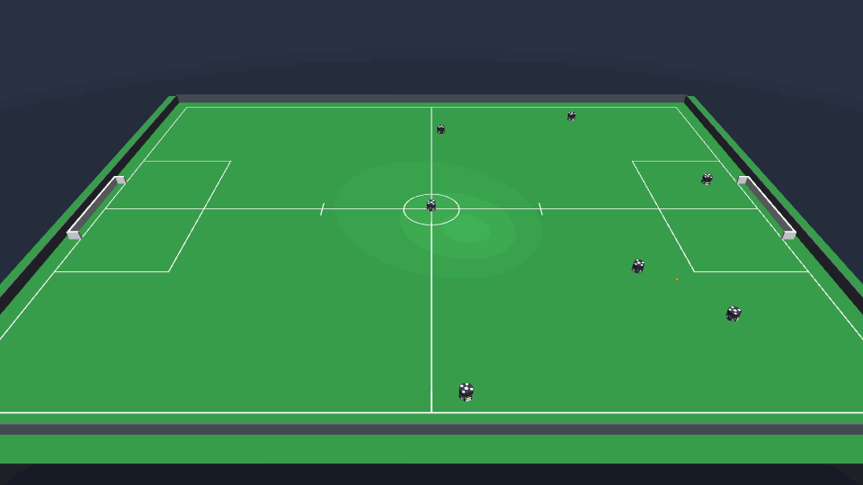

# StaticDefenders-v0



| | |
|---|---|
| Action Space | `Box(-1.0, 1.0, (7,), float32)` on the default tier 1, `Box(-1.0, 1.0, (6,), float32)` on tier 0 |
| Observation Space | `Box((62,), float32)`, bounded per row below |
| import | `gym.make("StaticDefenders-v0")` |

## Description

rSoccer's `SSLStaticDefenders-v0`: [`GoToBallShoot-v0`](go_to_ball_shoot.md)'s reward and
endings, with six yellow robots scattered at random over the attacking half. The robot starts
at the centre spot. The defenders get no commands, so they never move under their own power,
and there is no collision rule: touching one costs nothing, it is only in the way.

## Action Space

Unchanged from every other environment in the suite. The action is a
`Box(-1, 1, (7,), float32)` on the default tier 1, driving the one blue robot; the six
yellow robots are not controllable and never appear in it. Every element is normalised and
scaled internally by the actuator's own `ctrlrange`.

| Num | Action | Min | Max | Unit |
|---|---|---|---|---|
| 0 | wheel 1 speed (`wheel1_vel`) | -95 | 95 | rad/s |
| 1 | wheel 2 speed (`wheel2_vel`) | -95 | 95 | rad/s |
| 2 | wheel 3 speed (`wheel3_vel`) | -95 | 95 | rad/s |
| 3 | wheel 4 speed (`wheel4_vel`) | -95 | 95 | rad/s |
| 4 | kicker plunger force (`kicker_force`) | 0 | 500 | N, a one-step pulse for `6.5 * a` m/s when a > 0 |
| 5 | chipper plunger force (`chipper_force`) | 0 | 500 | N, a one-step pulse for `6.5 * a` m/s when a > 0 |
| 6 | dribbler bar speed (`dribbler_vel`) | 0 | 314 | rad/s |

On tier 0 the action is a `Box(-1, 1, (6,), float32)`: the four wheel servos are replaced by
the three chassis rows, and kicker, chipper and dribbler shift down to indices 3, 4 and 5.

| Num | Action | Min | Max | Unit |
|---|---|---|---|---|
| 0 | body-frame forward velocity (`vel_x`) | -4 | 4 | m/s |
| 1 | body-frame lateral velocity (`vel_y`) | -4 | 4 | m/s |
| 2 | yaw rate (`vel_yaw`) | -30 | 30 | rad/s |
| 3 | kicker plunger force (`kicker_force`) | 0 | 500 | N, a one-step pulse for `6.5 * a` m/s when a > 0 |
| 4 | chipper plunger force (`chipper_force`) | 0 | 500 | N, a one-step pulse for `6.5 * a` m/s when a > 0 |
| 5 | dribbler bar speed (`dribbler_vel`) | 0 | 314 | rad/s |

The chipper (row 5 on the default tier 1, row 4 on tier 0) is the control this task exists
to motivate.
Like the kicker it asks for a speed: `a <= 0` does not fire, `(0, 1]` sends the ball out at
`6.5 * a` m/s, and each shot locks that plunger out for 250 ms. The two
locks are independent, so a kick cannot block a chip. See
[the action space contract](../index.md#action-space).

## Observation Space

`Box((62,), float32)`, bounded per row below: 6 ball elements plus 8 for each of the 7 robots. Robots
appear in attach order — the controlled blue robot first, then the six yellow ones, which
is the same ordering rule as everywhere else in the suite, so indices 0-13 mean exactly what
they mean in `GoToBallShoot-v0`.

| Num | Observation | Min | Max | Name in XML / source | Unit |
|---|---|---|---|---|---|
| 0 | ball x position | -Inf | Inf | `ball` | m, / 6.0 (`FIELD_HALF_X`) |
| 1 | ball y position | -Inf | Inf | `ball` | m, / 4.5 (`FIELD_HALF_Y`) |
| 2 | ball height above the carpet | 0 | Inf | `ball` | m, / 0.155 (`GOAL_HEIGHT`) |
| 3 | ball x velocity | -Inf | Inf | `ball` | m/s, / 8.0 (`MAX_BALL_V`) |
| 4 | ball y velocity | -Inf | Inf | `ball` | m/s, / 8.0 (`MAX_BALL_V`) |
| 5 | ball z velocity | -Inf | Inf | `ball` | m/s, / 8.0 (`MAX_BALL_V`) |
| 6 | x position of the controlled blue robot | -1.05 | 1.05 | `b0_robot` | m, / 6.0 (`FIELD_HALF_X`) |
| 7 | y position of the controlled blue robot | -1.067 | 1.067 | `b0_robot` | m, / 4.5 (`FIELD_HALF_Y`) |
| 8 | sin of the yaw of the controlled blue robot | -1 | 1 | `b0_robot` | unitless |
| 9 | cos of the yaw of the controlled blue robot | -1 | 1 | `b0_robot` | unitless |
| 10 | world-frame x velocity of the controlled blue robot | -Inf | Inf | `b0_robot` | m/s, / 3.3 (`MAX_V`) |
| 11 | world-frame y velocity of the controlled blue robot | -Inf | Inf | `b0_robot` | m/s, / 3.3 (`MAX_V`) |
| 12 | yaw rate of the controlled blue robot | -Inf | Inf | `b0_robot` | rad/s, / 37.1 (`MAX_W`) |
| 13 | whether the controlled blue robot has the ball | 0 | 1 | `BaseEnv.holds` | 0 or 1 |
| 14 | x position of the yellow robot 0 | -1.05 | 1.05 | `y0_robot` | m, / 6.0 (`FIELD_HALF_X`) |
| 15 | y position of the yellow robot 0 | -1.067 | 1.067 | `y0_robot` | m, / 4.5 (`FIELD_HALF_Y`) |
| 16 | sin of the yaw of the yellow robot 0 | -1 | 1 | `y0_robot` | unitless |
| 17 | cos of the yaw of the yellow robot 0 | -1 | 1 | `y0_robot` | unitless |
| 18 | world-frame x velocity of the yellow robot 0 | -Inf | Inf | `y0_robot` | m/s, / 3.3 (`MAX_V`) |
| 19 | world-frame y velocity of the yellow robot 0 | -Inf | Inf | `y0_robot` | m/s, / 3.3 (`MAX_V`) |
| 20 | yaw rate of the yellow robot 0 | -Inf | Inf | `y0_robot` | rad/s, / 37.1 (`MAX_W`) |
| 21 | whether the yellow robot 0 has the ball | 0 | 1 | `BaseEnv.holds` | 0 or 1 |
| 22 | x position of the yellow robot 1 | -1.05 | 1.05 | `y1_robot` | m, / 6.0 (`FIELD_HALF_X`) |
| 23 | y position of the yellow robot 1 | -1.067 | 1.067 | `y1_robot` | m, / 4.5 (`FIELD_HALF_Y`) |
| 24 | sin of the yaw of the yellow robot 1 | -1 | 1 | `y1_robot` | unitless |
| 25 | cos of the yaw of the yellow robot 1 | -1 | 1 | `y1_robot` | unitless |
| 26 | world-frame x velocity of the yellow robot 1 | -Inf | Inf | `y1_robot` | m/s, / 3.3 (`MAX_V`) |
| 27 | world-frame y velocity of the yellow robot 1 | -Inf | Inf | `y1_robot` | m/s, / 3.3 (`MAX_V`) |
| 28 | yaw rate of the yellow robot 1 | -Inf | Inf | `y1_robot` | rad/s, / 37.1 (`MAX_W`) |
| 29 | whether the yellow robot 1 has the ball | 0 | 1 | `BaseEnv.holds` | 0 or 1 |
| 30 | x position of the yellow robot 2 | -1.05 | 1.05 | `y2_robot` | m, / 6.0 (`FIELD_HALF_X`) |
| 31 | y position of the yellow robot 2 | -1.067 | 1.067 | `y2_robot` | m, / 4.5 (`FIELD_HALF_Y`) |
| 32 | sin of the yaw of the yellow robot 2 | -1 | 1 | `y2_robot` | unitless |
| 33 | cos of the yaw of the yellow robot 2 | -1 | 1 | `y2_robot` | unitless |
| 34 | world-frame x velocity of the yellow robot 2 | -Inf | Inf | `y2_robot` | m/s, / 3.3 (`MAX_V`) |
| 35 | world-frame y velocity of the yellow robot 2 | -Inf | Inf | `y2_robot` | m/s, / 3.3 (`MAX_V`) |
| 36 | yaw rate of the yellow robot 2 | -Inf | Inf | `y2_robot` | rad/s, / 37.1 (`MAX_W`) |
| 37 | whether the yellow robot 2 has the ball | 0 | 1 | `BaseEnv.holds` | 0 or 1 |
| 38 | x position of the yellow robot 3 | -1.05 | 1.05 | `y3_robot` | m, / 6.0 (`FIELD_HALF_X`) |
| 39 | y position of the yellow robot 3 | -1.067 | 1.067 | `y3_robot` | m, / 4.5 (`FIELD_HALF_Y`) |
| 40 | sin of the yaw of the yellow robot 3 | -1 | 1 | `y3_robot` | unitless |
| 41 | cos of the yaw of the yellow robot 3 | -1 | 1 | `y3_robot` | unitless |
| 42 | world-frame x velocity of the yellow robot 3 | -Inf | Inf | `y3_robot` | m/s, / 3.3 (`MAX_V`) |
| 43 | world-frame y velocity of the yellow robot 3 | -Inf | Inf | `y3_robot` | m/s, / 3.3 (`MAX_V`) |
| 44 | yaw rate of the yellow robot 3 | -Inf | Inf | `y3_robot` | rad/s, / 37.1 (`MAX_W`) |
| 45 | whether the yellow robot 3 has the ball | 0 | 1 | `BaseEnv.holds` | 0 or 1 |
| 46 | x position of the yellow robot 4 | -1.05 | 1.05 | `y4_robot` | m, / 6.0 (`FIELD_HALF_X`) |
| 47 | y position of the yellow robot 4 | -1.067 | 1.067 | `y4_robot` | m, / 4.5 (`FIELD_HALF_Y`) |
| 48 | sin of the yaw of the yellow robot 4 | -1 | 1 | `y4_robot` | unitless |
| 49 | cos of the yaw of the yellow robot 4 | -1 | 1 | `y4_robot` | unitless |
| 50 | world-frame x velocity of the yellow robot 4 | -Inf | Inf | `y4_robot` | m/s, / 3.3 (`MAX_V`) |
| 51 | world-frame y velocity of the yellow robot 4 | -Inf | Inf | `y4_robot` | m/s, / 3.3 (`MAX_V`) |
| 52 | yaw rate of the yellow robot 4 | -Inf | Inf | `y4_robot` | rad/s, / 37.1 (`MAX_W`) |
| 53 | whether the yellow robot 4 has the ball | 0 | 1 | `BaseEnv.holds` | 0 or 1 |
| 54 | x position of the yellow robot 5 | -1.05 | 1.05 | `y5_robot` | m, / 6.0 (`FIELD_HALF_X`) |
| 55 | y position of the yellow robot 5 | -1.067 | 1.067 | `y5_robot` | m, / 4.5 (`FIELD_HALF_Y`) |
| 56 | sin of the yaw of the yellow robot 5 | -1 | 1 | `y5_robot` | unitless |
| 57 | cos of the yaw of the yellow robot 5 | -1 | 1 | `y5_robot` | unitless |
| 58 | world-frame x velocity of the yellow robot 5 | -Inf | Inf | `y5_robot` | m/s, / 3.3 (`MAX_V`) |
| 59 | world-frame y velocity of the yellow robot 5 | -Inf | Inf | `y5_robot` | m/s, / 3.3 (`MAX_V`) |
| 60 | yaw rate of the yellow robot 5 | -Inf | Inf | `y5_robot` | rad/s, / 37.1 (`MAX_W`) |
| 61 | whether the yellow robot 5 has the ball | 0 | 1 | `BaseEnv.holds` | 0 or 1 |

The defenders' pose entries are constant within an episode and identical across episodes,
since `_place` puts them at fixed coordinates every reset; their velocity entries are zero
unless something has hit them. Their `has_ball` entries are computed the same way as
everyone else's, so a ball trapped against a defender's dribbler reads as that defender
holding it.

## Rewards

Ported from rSoccer's `_calculate_reward_and_done` (`ssl_go_to_ball_shoot`, and the
identical one in `ssl_hw_challenge`). Per step, unless the step ends the episode:

| term | value |
|---|---|
| ball distance | `clip(prev_dist - dist, -1, 1) / BALL_DIST_SCALE`, robot-to-ball closing; `BALL_DIST_SCALE = hypot(9.0, 6.0) = 10.8` |
| ball gradient | `clip(prev - now, -1, 1) / BALL_GRAD_SCALE`, the ball closing on the goal centre `(6.0, 0)`; `BALL_GRAD_SCALE = hypot(4.5, 6.0) / 4 = 1.875` |
| energy | `-mean(|a_drive|) / 1000` |

On an ending step the only reward is the goal: `+5.0` for a ball past `x = 6.0` inside the
mouth, `0` for anything else. There are no penalties. The scales are rSoccer's formulas on our
field. rSoccer's energy is `sum |wheel speed| / (4 * 160 rad/s * 1000)`; here the commanded drive,
as a fraction of its range, stands in for the wheel speed (tier 0 commands `(vx, vy, w)`, not
wheels), so a saturated drive costs `1 / 1000` a step as there.

## Starting State

rSoccer's layout. The robot starts at `(0, 0)` facing +x. The ball is uniform over `x` in
`[0.2, 5.9]`, `y` in `[-4.4, 4.4]`, redrawn while inside the penalty area. The six defenders are
drawn from the same box (penalty area allowed), each at least 0.2 m from the ball, the robot
and each other, with yaw uniform over `[0, 2 pi)`.

## Episode End

### Termination

Checked in rSoccer's order, the first that holds ends the episode:

- **Robot out.** The robot leaves the attacking half (`x < -0.2`) or the field's width
  (`|y| > 4.5`). `info["robot_out"]`.
- **Goalkeeper area.** The robot enters the +x penalty area (`x > 4.2`, `|y| < 1.8`, Div A's
  1.8 x 3.6 m). `info["gk_area"]`.
- **Ball out.** The ball leaves the attacking half (`x < 0`) or the width. `info["ball_out"]`.
- **Goal line.** The ball crosses `x = 6.0`: `+5.0` and `info["goal"]` inside the mouth (and
  under the crossbar), `0` wide.
- **Controlled robot turned over** (tier 1 only). The robot's own +z tilts more than 60 deg
  off world +z (`cos < 0.5`); the step pays `-100.0` and `info["tipped"]` is set. rSoccer's
  robots cannot tip, so this is the one ending that is ours, kept so a robot on its back never
  collects shaping.
- **Diverged simulation.** If `qpos` or `qvel` stops being finite, `step` raises
  `RuntimeError` rather than returning a NaN observation to train on.

### Truncation

`steps >= max_steps`, where `max_steps = round(horizon_s / dt)`. The default horizon is
**25 s**, rSoccer's: **1000 steps** at the 40 Hz (0.025 s) the agents act at, rSoccer's step,
and 1500 at the default `control_hz=60`.

## Arguments

| parameter | type | default | description |
|---|---|---|---|
| `tier` | `int` | `1` | `1` = roller wheels with real slip, the default; `0` = the faster kinematic chassis |
| `control_hz` | `int` | `60` | control rate, exact: it must divide the 960 Hz physics rate (30, 60, 120, ...), or the env raises `ValueError` |
| `horizon_s` | `float` | `25.0` | truncation horizon, in seconds |
| `render_mode` | `str \| None` | `None` | `"human"` or `"rgb_array"` |

```python
import gymnasium as gym
import mjsoccer

env = gym.make("StaticDefenders-v0", tier=0, control_hz=60, horizon_s=25.0, render_mode="rgb_array")
```

`n_yellow` (6) is a class attribute on `StaticDefendersEnv`, not a `gym.make` keyword — it
determines the compiled model, and therefore the observation dimension.

## Info dictionary

| key | type | description |
|---|---|---|
| `is_success` | `bool` | the ball ended up in the goal |
| `goal` | `bool` | present on a step the ball crossed the goal line: inside the mouth or not |
| `robot_out` | `bool` | present when the robot left the attacking half or the width |
| `gk_area` | `bool` | present when the robot entered the penalty area |
| `ball_out` | `bool` | present when the ball left the attacking half or the width |
| `tipped` | `bool` | present only on the step a controlled robot turned over |
| `tilt_deg` | `float` | with `tipped`: the worst controlled robot's tilt off vertical, degrees |
| `tip_step` | `int` | with `tipped`: control steps since reset, so time-to-tip is `tip_step * dt` |

## Version History

- v0: initial release.
