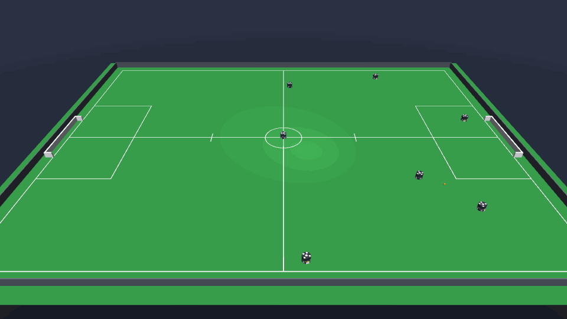

# StaticDefenders-v0



| | |
|---|---|
| Action Space | `Box(-1.0, 1.0, (7,), float32)` |
| Observation Space | `Box((62,), float32)`, bounded per row below |
| import | `gym.make("StaticDefenders-v0")` |

## Description

rSoccer's `SSLStaticDefenders-v0`: [`GoToBallShoot-v0`](go_to_ball_shoot.md)'s reward and
endings, with six yellow robots scattered at random over the attacking half. The robot starts
at the centre spot. The defenders get no commands, so they never move under their own power,
and there is no collision rule: touching one costs nothing, it is only in the way.

## Action Space

The action is a `Box(-1, 1, (7,), float32)` and drives the blue robot only; the yellow robots are
not controllable and never appear in it.

| Num | Action | Min | Max | Unit |
|---|---|---|---|---|
| 0 | target x | -6.0 | 6.0 | m, `a * 6.0` (`FIELD_HALF_X`) |
| 1 | target y | -4.5 | 4.5 | m, `a * 4.5` (`FIELD_HALF_Y`) |
| 2 | sin of the target heading | -1 | 1 | heading `atan2(a_2, a_3)` |
| 3 | cos of the target heading | -1 | 1 | |
| 4 | kick speed (`kicker_force`) | 0 | 6.5 | m/s, `6.5 * a` for `a > 0`; `a <= 0` does not fire |
| 5 | chip speed (`chipper_force`) | 0 | 6.5 | m/s, `6.5 * a` for `a > 0`; `a <= 0` does not fire |
| 6 | dribbler bar speed (`dribbler_vel`) | 0 | 314 | rad/s, `314 * max(a, 0)` (`DRIBBLER_OMEGA`) |

Rows 0-3 are a target pose (target velocity 0) that the navigation controller turns into a
body-frame velocity every 25 ms control step. Rows 4-5 ask for a ball speed, not a force:
`KICK_TABLE_MS` maps `6.5 * a` m/s to a one-step plunger force (`a = 1` lands at ~295-315 N;
the actuators' `ctrlrange` is 0..500 N). Each shot locks that plunger out for 250 ms; the
kicker and chipper locks are independent, so a kick cannot block a chip. Row 6 is off for
`a <= 0` and never drives the bar backwards (its `ctrlrange` is +-1500 rad/s; the action uses
only 0..314). See [the action space contract](../index.md#action-space).

The chipper (row 5) is the control this task exists to motivate: a chip clears a defender.

## Observation Space

`Box((62,), float32)`: 6 ball elements plus 8 for each of the 7 robots: the controlled blue
robot first, then the six yellow ones, so indices 0-13 mean exactly what they mean in
`GoToBallShoot-v0`.

| Num | Observation | Min | Max | Name in XML / source | Unit |
|---|---|---|---|---|---|
| 0 | ball x position | -Inf | Inf | `ball` | m, / 6.0 (`FIELD_HALF_X`) |
| 1 | ball y position | -Inf | Inf | `ball` | m, / 4.5 (`FIELD_HALF_Y`) |
| 2 | ball height above the carpet | 0 | Inf | `ball` | m, / 0.155 (`GOAL_HEIGHT`) |
| 3 | ball x velocity | -Inf | Inf | `ball` | m/s, / 8.0 (`MAX_BALL_V`) |
| 4 | ball y velocity | -Inf | Inf | `ball` | m/s, / 8.0 (`MAX_BALL_V`) |
| 5 | ball z velocity | -Inf | Inf | `ball` | m/s, / 8.0 (`MAX_BALL_V`) |
| 6 | x position of the controlled blue robot | -1.05 | 1.05 | `b0_robot` | m, / 6.0 (`FIELD_HALF_X`) |
| 7 | y position of the controlled blue robot | -1.067 | 1.067 | `b0_robot` | m, / 4.5 (`FIELD_HALF_Y`) |
| 8 | sin of the yaw of the controlled blue robot | -1 | 1 | `b0_robot` | unitless |
| 9 | cos of the yaw of the controlled blue robot | -1 | 1 | `b0_robot` | unitless |
| 10 | world-frame x velocity of the controlled blue robot | -Inf | Inf | `b0_robot` | m/s, / 3.3 (`MAX_V`) |
| 11 | world-frame y velocity of the controlled blue robot | -Inf | Inf | `b0_robot` | m/s, / 3.3 (`MAX_V`) |
| 12 | yaw rate of the controlled blue robot | -Inf | Inf | `b0_robot` | rad/s, / 37.1 (`MAX_W`) |
| 13 | whether the controlled blue robot has the ball | 0 | 1 | `BaseEnv.holds` | 0 or 1 |
| 14 | x position of yellow robot 0 | -1.05 | 1.05 | `y0_robot` | m, / 6.0 (`FIELD_HALF_X`) |
| 15 | y position of yellow robot 0 | -1.067 | 1.067 | `y0_robot` | m, / 4.5 (`FIELD_HALF_Y`) |
| 16 | sin of the yaw of yellow robot 0 | -1 | 1 | `y0_robot` | unitless |
| 17 | cos of the yaw of yellow robot 0 | -1 | 1 | `y0_robot` | unitless |
| 18 | world-frame x velocity of yellow robot 0 | -Inf | Inf | `y0_robot` | m/s, / 3.3 (`MAX_V`) |
| 19 | world-frame y velocity of yellow robot 0 | -Inf | Inf | `y0_robot` | m/s, / 3.3 (`MAX_V`) |
| 20 | yaw rate of yellow robot 0 | -Inf | Inf | `y0_robot` | rad/s, / 37.1 (`MAX_W`) |
| 21 | whether yellow robot 0 has the ball | 0 | 1 | `BaseEnv.holds` | 0 or 1 |
| 22 | x position of yellow robot 1 | -1.05 | 1.05 | `y1_robot` | m, / 6.0 (`FIELD_HALF_X`) |
| 23 | y position of yellow robot 1 | -1.067 | 1.067 | `y1_robot` | m, / 4.5 (`FIELD_HALF_Y`) |
| 24 | sin of the yaw of yellow robot 1 | -1 | 1 | `y1_robot` | unitless |
| 25 | cos of the yaw of yellow robot 1 | -1 | 1 | `y1_robot` | unitless |
| 26 | world-frame x velocity of yellow robot 1 | -Inf | Inf | `y1_robot` | m/s, / 3.3 (`MAX_V`) |
| 27 | world-frame y velocity of yellow robot 1 | -Inf | Inf | `y1_robot` | m/s, / 3.3 (`MAX_V`) |
| 28 | yaw rate of yellow robot 1 | -Inf | Inf | `y1_robot` | rad/s, / 37.1 (`MAX_W`) |
| 29 | whether yellow robot 1 has the ball | 0 | 1 | `BaseEnv.holds` | 0 or 1 |
| 30 | x position of yellow robot 2 | -1.05 | 1.05 | `y2_robot` | m, / 6.0 (`FIELD_HALF_X`) |
| 31 | y position of yellow robot 2 | -1.067 | 1.067 | `y2_robot` | m, / 4.5 (`FIELD_HALF_Y`) |
| 32 | sin of the yaw of yellow robot 2 | -1 | 1 | `y2_robot` | unitless |
| 33 | cos of the yaw of yellow robot 2 | -1 | 1 | `y2_robot` | unitless |
| 34 | world-frame x velocity of yellow robot 2 | -Inf | Inf | `y2_robot` | m/s, / 3.3 (`MAX_V`) |
| 35 | world-frame y velocity of yellow robot 2 | -Inf | Inf | `y2_robot` | m/s, / 3.3 (`MAX_V`) |
| 36 | yaw rate of yellow robot 2 | -Inf | Inf | `y2_robot` | rad/s, / 37.1 (`MAX_W`) |
| 37 | whether yellow robot 2 has the ball | 0 | 1 | `BaseEnv.holds` | 0 or 1 |
| 38 | x position of yellow robot 3 | -1.05 | 1.05 | `y3_robot` | m, / 6.0 (`FIELD_HALF_X`) |
| 39 | y position of yellow robot 3 | -1.067 | 1.067 | `y3_robot` | m, / 4.5 (`FIELD_HALF_Y`) |
| 40 | sin of the yaw of yellow robot 3 | -1 | 1 | `y3_robot` | unitless |
| 41 | cos of the yaw of yellow robot 3 | -1 | 1 | `y3_robot` | unitless |
| 42 | world-frame x velocity of yellow robot 3 | -Inf | Inf | `y3_robot` | m/s, / 3.3 (`MAX_V`) |
| 43 | world-frame y velocity of yellow robot 3 | -Inf | Inf | `y3_robot` | m/s, / 3.3 (`MAX_V`) |
| 44 | yaw rate of yellow robot 3 | -Inf | Inf | `y3_robot` | rad/s, / 37.1 (`MAX_W`) |
| 45 | whether yellow robot 3 has the ball | 0 | 1 | `BaseEnv.holds` | 0 or 1 |
| 46 | x position of yellow robot 4 | -1.05 | 1.05 | `y4_robot` | m, / 6.0 (`FIELD_HALF_X`) |
| 47 | y position of yellow robot 4 | -1.067 | 1.067 | `y4_robot` | m, / 4.5 (`FIELD_HALF_Y`) |
| 48 | sin of the yaw of yellow robot 4 | -1 | 1 | `y4_robot` | unitless |
| 49 | cos of the yaw of yellow robot 4 | -1 | 1 | `y4_robot` | unitless |
| 50 | world-frame x velocity of yellow robot 4 | -Inf | Inf | `y4_robot` | m/s, / 3.3 (`MAX_V`) |
| 51 | world-frame y velocity of yellow robot 4 | -Inf | Inf | `y4_robot` | m/s, / 3.3 (`MAX_V`) |
| 52 | yaw rate of yellow robot 4 | -Inf | Inf | `y4_robot` | rad/s, / 37.1 (`MAX_W`) |
| 53 | whether yellow robot 4 has the ball | 0 | 1 | `BaseEnv.holds` | 0 or 1 |
| 54 | x position of yellow robot 5 | -1.05 | 1.05 | `y5_robot` | m, / 6.0 (`FIELD_HALF_X`) |
| 55 | y position of yellow robot 5 | -1.067 | 1.067 | `y5_robot` | m, / 4.5 (`FIELD_HALF_Y`) |
| 56 | sin of the yaw of yellow robot 5 | -1 | 1 | `y5_robot` | unitless |
| 57 | cos of the yaw of yellow robot 5 | -1 | 1 | `y5_robot` | unitless |
| 58 | world-frame x velocity of yellow robot 5 | -Inf | Inf | `y5_robot` | m/s, / 3.3 (`MAX_V`) |
| 59 | world-frame y velocity of yellow robot 5 | -Inf | Inf | `y5_robot` | m/s, / 3.3 (`MAX_V`) |
| 60 | yaw rate of yellow robot 5 | -Inf | Inf | `y5_robot` | rad/s, / 37.1 (`MAX_W`) |
| 61 | whether yellow robot 5 has the ball | 0 | 1 | `BaseEnv.holds` | 0 or 1 |

Positions and velocities are divided by the constants in the Unit column; yaw is given as
its sine and cosine so the wrap at +-pi is not a discontinuity. Ball height is measured from
the carpet and normalised by `GOAL_HEIGHT = 0.155 m`, so a chipped ball reads greater than 1
exactly when it is too high to score. Only robot position, yaw and `has_ball` are bounded:
nothing clips, so a bound exists only where the field walls guarantee it.

The defenders' pose entries are constant within an episode (only contact moves them) and
resampled at every reset; their velocity entries are zero unless something has hit them.
Their `has_ball` entries are computed the same way as everyone else's, so a ball trapped
against a defender's dribbler reads as that defender holding it.

## Rewards

Ported from rSoccer's `_calculate_reward_and_done` (`ssl_go_to_ball_shoot`, and the
identical one in `ssl_hw_challenge`). The three shaping terms are paid on every step that
does not end on robot out, goalkeeper area, ball out or the goal line; such a step pays only
the goal term (`+5.0` or `0`). There are no terminal penalties. The scales are rSoccer's
formulas on our field. `drive_cmd` is the navigation controller's body-frame `(vx, vy, w)`
command as a fraction of the chassis servos' `ctrlrange`, clipped to `[-1, 1]`; it stands in
for rSoccer's `sum |wheel speed| / (4 * 160 rad/s * 1000)` (the chassis is commanded in
`(vx, vy, w)`, not wheels), so a saturated drive costs `1 / 1000` a step as there.

| term | value |
|---|---|
| ball distance | `clip(prev_dist - dist, -1, 1) / ROBOT_STEP_SCALE`, robot-to-ball closing; `ROBOT_STEP_SCALE = MAX_V * CONTROL_DT = 0.0825 m`, one control step at full speed, so ~`+1` per step driving straight at the ball (rSoccer divides by `hypot(9, 6) = 10.8`) |
| ball gradient | `clip(prev - now, -1, 1) / BALL_GRAD_SCALE`, the ball closing on the goal centre `(6.0, 0)`; `BALL_GRAD_SCALE = hypot(4.5, 6.0) / 4 = 1.875` |
| energy | `-mean(\|drive_cmd\|) / 1000` |
| goal | `+5.0` on the step the ball crosses `x = 6.0` inside the mouth, `0` wide; ends the episode |

## Starting State

rSoccer's layout. The robot starts at `(0, 0)` facing +x. The ball is uniform over `x` in
`[0.2, 5.9]`, `y` in `[-4.4, 4.4]`, redrawn while inside the penalty area. The six defenders are
drawn from the same box (penalty area allowed), each resampled until it is at least 0.2 m
from the ball, the robot and each other, with yaw uniform over `[0, 2 pi)`. Everything starts
at rest.
(GPU backends: the first clear draw out of a fixed candidate set (8 for the ball, 8 per defender); if none is clear, the roomiest one, flagged `reset_overlap`. See [the backends](../backends/index.md).)

## Episode End

### Termination

Checked in rSoccer's order; the first that holds ends the episode:

- **Robot out.** The robot leaves the attacking half (`x < -0.2`) or the field's width
  (`|y| > 4.5`). `info["robot_out"]`.
- **Goalkeeper area.** The robot enters the +x penalty area (`x > 4.2`, `|y| < 1.8`, Div A's
  1.8 x 3.6 m). `info["gk_area"]`.
- **Ball out.** The ball leaves the attacking half (`x < 0`) or the width. `info["ball_out"]`.
- **Goal line.** The ball crosses `x = 6.0`: `+5.0` and `info["goal"]` inside the mouth (and
  under the crossbar), `0` wide.
- **Diverged simulation.** If `qpos` or `qvel` stops being finite, `step` raises
  `RuntimeError` rather than returning a NaN observation to train on. (GPU backends end that
  world with obs and reward 0, count it in `diverged` and auto-reset; see [the backends](../backends/index.md).)

### Truncation

`steps >= max_steps`, where `max_steps = round(horizon_s / dt)`. The default horizon is
**25 s**, rSoccer's: **1000 control steps** at the fixed 40 Hz (0.025 s), rSoccer's step.

## Arguments

| parameter | type | default | description |
|---|---|---|---|
| `repeat_action` | `int` | `1` | control steps (25 ms each, fixed 40 Hz) one decision is held for |
| `horizon_s` | `float` | `25.0` | truncation horizon, in seconds |
| `render_mode` | `str \| None` | `None` | `"human"` or `"rgb_array"` |
| `viewer_gfx` | `str` | `"opengl_headless"` | how `"human"` mode draws: `"opengl_headless"` or `"web"` |

```python
import gymnasium as gym
import mjsoccer

env = gym.make("StaticDefenders-v0", horizon_s=25.0, render_mode="rgb_array")
```

`n_yellow` (6) and `energy_steps` (1000, the energy term's divisor) are class attributes, not `gym.make` keywords; the robot counts determine the compiled model, and therefore the observation size. The GPU backends read them off the CPU class.

## Info dictionary

| key | type | description |
|---|---|---|
| `is_success` | `bool` | the ball ended up in the goal |
| `goal` | `bool` | present on a step the ball crossed the goal line: inside the mouth or not |
| `robot_out` | `bool` | present when the robot left the attacking half or the width |
| `gk_area` | `bool` | present when the robot entered the penalty area |
| `ball_out` | `bool` | present when the ball left the attacking half or the width |

These keys are returned by the CPU (Gymnasium) env only; the GPU backends do not return them. See [the backends](../backends/index.md).

## Version History

- v0: initial release.
